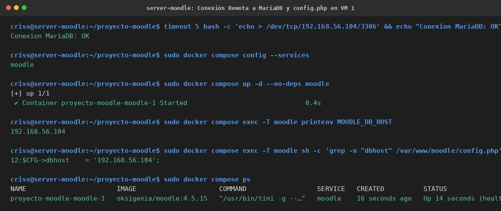

# PASO 13.03 — Conexión de Moodle en VM 1 a MariaDB Remota

> **Naturaleza:** Procedimiento técnico de reconfiguración del Web Tier en VM 1.
>
> **Entorno:** VM 1 (Ubuntu Server Moodle `192.168.56.103`).

## Archivos relacionados y por qué importan

- **`/home/criss/proyecto-moodle/compose.yaml`**: archivo Compose de VM 1 donde Moodle apunta al host de base de datos remoto `192.168.56.104` y se elimina la dependencia del contenedor `db` local.
- **`/home/criss/proyecto-moodle/compose.antes-red.yaml`**: copia de respaldo del Compose monolítico en VM 1 para posibilitar una reversión instantánea.
- **`/var/www/moodle/config.php`** (dentro del contenedor Moodle): archivo de configuración donde la imagen Oksigenia inyecta la directiva `$CFG->dbhost`.
- **[`evidencias/EV-134.md`](13-03/evidencias/EV-134.md)**: ficha de verificación de socket TCP, Compose de Moodle y `config.php`.

## Propósito del paso

Reconfigurar la aplicación Moodle en VM 1 para que consuma la base de datos alojada en VM 2:
1. Comprobar la alcanzabilidad del socket TCP `192.168.56.104:3306` desde VM 1.
2. Detener los servicios locales de Moodle y MariaDB en VM 1.
3. Modificar `compose.yaml` en VM 1 eliminando el servicio `db`, retirando `depends_on: db` y definiendo `MOODLE_DB_HOST: 192.168.56.104` y `MOODLE_DB_PORT: "3306"`.
4. Iniciar el contenedor Moodle y comprobar que la imagen Oksigenia regenere de forma dinámica `/var/www/moodle/config.php` con `$CFG->dbhost = '192.168.56.104'`.

## Procedimiento detallado y comandos ejecutados

### 1. Comprobación de Conectividad TCP al Puerto 3306

Desde VM 1:
```bash
timeout 5 bash -c 'echo > /dev/tcp/192.168.56.104/3306' \
  && echo "Conexion MariaDB: OK" \
  || echo "No se puede conectar al puerto 3306"
```
*Salida observada:* `Conexion MariaDB: OK`.

### 2. Modificación de Compose en VM 1

En `/home/criss/proyecto-moodle`:
```bash
cd /home/criss/proyecto-moodle
cp -p compose.yaml compose.antes-red.yaml
sudo docker compose stop moodle db
```

Se edita `compose.yaml` para dejar únicamente el servicio `moodle` configurado hacia la base remota:

```yaml
services:
  moodle:
    image: oksigenia/moodle:4.5.15
    restart: unless-stopped

    ports:
      - "127.0.0.1:8080:8080"

    environment:
      MOODLE_URL: https://aulavirtual.ctcr
      MOODLE_SSL_PROXY: "yes"
      MOODLE_DB_TYPE: mariadb
      MOODLE_DB_HOST: 192.168.56.104
      MOODLE_DB_PORT: "3306"
      MOODLE_DB_NAME: moodle
      MOODLE_DB_USER: moodle
      MOODLE_DB_PASSWORD: ${DB_PASSWORD}
      MOODLE_ADMIN_USER: admin
      MOODLE_ADMIN_PASSWORD: ${MOODLE_ADMIN_PASSWORD}
      MOODLE_SITE_NAME: Colegio Tecnico
      MOODLE_SITE_SHORTNAME: Colegio
      MOODLE_LANG: es
      MOODLE_TIMEZONE: America/Costa_Rica

    volumes:
      - moodle_code:/var/www/moodle
      - moodle_data:/var/www/moodledata

volumes:
  mariadb_data:
  moodle_code:
  moodle_data:
```

Se valida la configuración:
```bash
sudo docker compose config -q
sudo docker compose config --services
```
*Salida:* `moodle`.

### 3. Puesta en Marcha de Moodle y Comprobación de Configuración Efectiva

```bash
sudo docker compose up -d --no-deps moodle
sudo docker compose ps
```

Se inspecciona la variable de entorno y el archivo `/var/www/moodle/config.php`:
```bash
sudo docker compose exec -T moodle printenv MOODLE_DB_HOST
sudo docker compose exec -T moodle sh -c 'grep -n "dbhost" /var/www/moodle/config.php'
```
*Salidas observadas:*
- `MOODLE_DB_HOST` = `192.168.56.104`.
- Línea 12 en `config.php`: `$CFG->dbhost = '192.168.56.104';`.
- Línea 19 en `config.php`: `'dbport' => 3306,`.

Logs de inicialización (`sudo docker compose logs --tail=40 moodle`):
```text
[moodle] Connecting to the mariadb database at 192.168.56.104:3306
[moodle] Moodle is ready at https://aulavirtual.ctcr
```

## Evidencia documentada

La verificación de socket TCP, el Compose de VM 1, la variable de entorno, `config.php` y el estado saludable de Moodle están registrados en:


*Detalles en la ficha contextual [EV-134](13-03/evidencias/EV-134.md).*

## Criterio de aceptación

- [x] Socket TCP a `192.168.56.104:3306` responde exitosamente en VM 1.
- [x] Compose en VM 1 contiene exclusivamente el servicio `moodle` sin `depends_on: db`.
- [x] Variable `MOODLE_DB_HOST` es `192.168.56.104`.
- [x] `/var/www/moodle/config.php` contiene `$CFG->dbhost = '192.168.56.104';`.
- [x] El contenedor `proyecto-moodle-moodle-1` alcanza el estado `healthy`.
