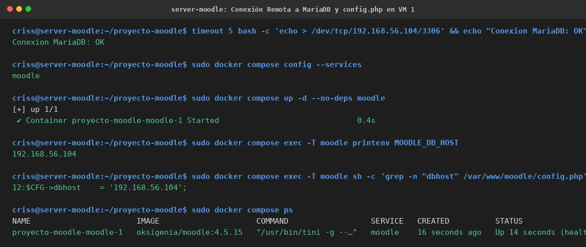

# EV-134 — Conexión Remota a MariaDB y config.php en VM 1

**Procedencia:** Laboratorio EIF431O, Fase Opcional. Captura en VM 1 (Moodle `192.168.56.103`). **Paso relacionado:** [13-03](../../13-03.md).

## Qué ocurre en esta captura

En VM 1 (`criss@server-moodle`):
1. Verificación de socket TCP remoto: `timeout 5 bash -c 'echo > /dev/tcp/192.168.56.104/3306' && echo "Conexion MariaDB: OK"` responde exitosamente `Conexion MariaDB: OK`.
2. Inspección de servicios Compose en VM 1: `sudo docker compose config --services` muestra únicamente `moodle`.
3. Despliegue de Moodle con `sudo docker compose up -d --no-deps moodle`.
4. Comprobación de variable de entorno en contenedor: `printenv MOODLE_DB_HOST` devuelve `192.168.56.104`.
5. Inspección del archivo persistente `/var/www/moodle/config.php`: línea 12 confirma `$CFG->dbhost = '192.168.56.104';` regenerado por la imagen Oksigenia.
6. Verificación de estado del contenedor: `proyecto-moodle-moodle-1` en estado `healthy` con puerto `127.0.0.1:8080->8080/tcp`.

## Interpretación y límite de la evidencia

Acredita que Moodle en VM 1 resolvió y configuró la base de datos remota en `192.168.56.104:3306`, desvinculándose de cualquier contenedor de base de datos local y alcanzando el estado saludable. No prueba de forma directa la respuesta HTTP/HTTPS del proxy inverso Nginx ni la navegación web de usuarios, lo cual se aborda en EV-135.

## Reproducir y verificar

1. Seguir el procedimiento [13-03](../../13-03.md) en VM 1.
2. Confirmar la salida de `printenv MOODLE_DB_HOST` y `grep dbhost /var/www/moodle/config.php`.

## Identidad, trazabilidad y privacidad

- **Identificador permanente:** `EV-134`.
- **Archivo de imagen:** `EV-134.webp`.
- **SHA-256 de la imagen incorporada:** `fc51d7a8f3867a8d79c7bf9b590f8dc0886b3db6721a0f9b1b616b47268c6c93`.
- **Origen:** Integración multi-VM y arranque de Moodle en VM 1, 2026-11-07.
- **VM:** VM 1 (`criss@server-moodle`, `192.168.56.103`).
- **Estado de revisión:** `VERIFICADA, revisada`.
- **Política de privacidad:** Sin credenciales ni datos personales.
