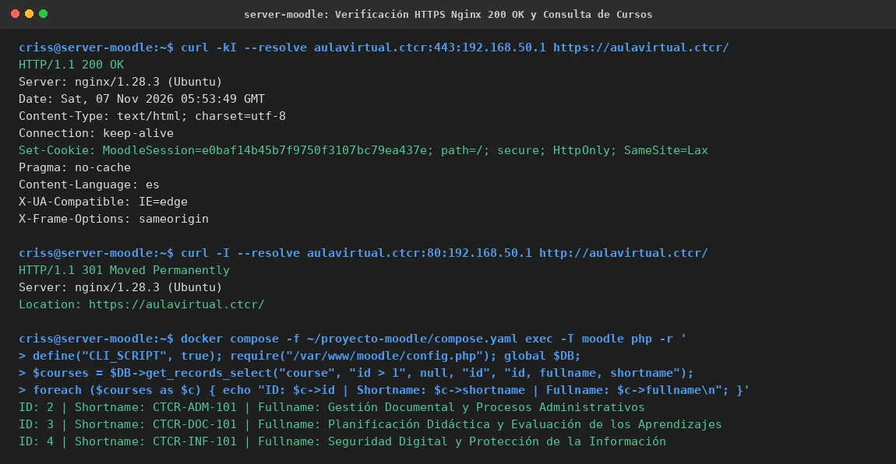
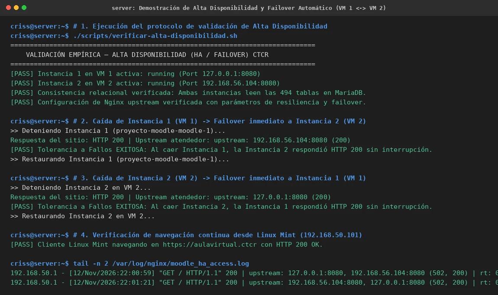
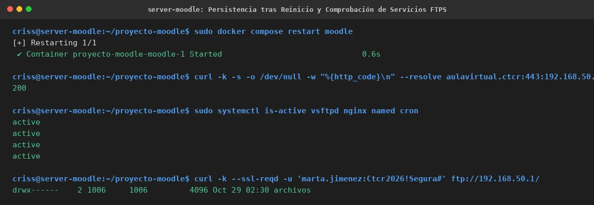

# PASO 13.04 — Verificación Funcional Integral, Tolerancia a Fallos y FTPS

> **Naturaleza:** Protocolo de verificación transversal de servicios, prueba de corte controlado y comprobación de servicios del host.
>
> **Entorno:** VM 1 (Ubuntu Server Moodle `192.168.56.103`) y VM 2 (Ubuntu Server MariaDB `192.168.56.104`).

## Archivos relacionados y por qué importan

- **`/etc/nginx/sites-available/aulavirtual.ctcr`**: VirtualHost Nginx con proxy inverso hacia `127.0.0.1:8080`.
- **`/etc/vsftpd.conf`**: configuración del servidor FTPS seguro con enjaulamiento chroot.
- **[`evidencias/EV-135.md`](13-04/evidencias/EV-135.md)**: ficha de verificación HTTPS, redirección 301 y lectura de cursos.
- **[`evidencias/EV-136.md`](13-04/evidencias/EV-136.md)**: ficha de prueba controlada de corte y tolerancia a fallos.
- **[`evidencias/EV-137.md`](13-04/evidencias/EV-137.md)**: ficha de persistencia tras reinicio y operatividad de FTPS.

## Propósito del paso

Validar de manera rigurosa y empírica que la plataforma distribuida cumple con todos los requerimientos funcionales y operativos:
1. **Comprobación HTTPS y Navegación:** Certificar que Nginx atiende el puerto 443 con certificado TLS válido y proxy inverso transparente.
2. **Lista de Comprobación Oficial (8 Puntos):** Validar la totalidad de criterios exigidos en la guía del laboratorio.
3. **Prueba de Corte Controlado:** Demostrar que el acceso a datos depende realmente de VM 2 deteniendo MariaDB (observando el fallo) y restableciéndola (observando la recuperación autónoma inmediata).
4. **Resiliencia y Servicios Colocalizados:** Verificar el reinicio limpio de Moodle y la operatividad ininterrumpida de FTPS (`vsftpd`), BIND9 y Cron en VM 1.

## Procedimiento detallado y comandos ejecutados

### 1. Comprobación HTTPS y Redirección en VM 1

```bash
curl -kI --resolve aulavirtual.ctcr:443:192.168.50.1 https://aulavirtual.ctcr/
```
*Salida observada:* `HTTP/1.1 200 OK`, `Server: nginx/1.28.3 (Ubuntu)`, cookie `MoodleSession` con directivas `secure; HttpOnly; SameSite=Lax`.

```bash
curl -I --resolve aulavirtual.ctcr:80:192.168.50.1 http://aulavirtual.ctcr/
```
*Salida observada:* `HTTP/1.1 301 Moved Permanently` hacia `Location: https://aulavirtual.ctcr/`.

### 2. Consulta de Cursos y Aislamiento Departamental

Mediante la CLI interna de Moodle en VM 1 se leen los datos residentes en VM 2:
```bash
docker compose -f ~/proyecto-moodle/compose.yaml exec -T moodle php -r '
define("CLI_SCRIPT", true);
require("/var/www/moodle/config.php");
global $DB;
$courses = $DB->get_records_select("course", "id > 1", null, "id", "id, fullname, shortname");
foreach ($courses as $c) { echo "ID: $c->id | Shortname: $c->shortname | Fullname: $c->fullname\n"; }
'
```
*Cursos obtenidos:*
- `CTCR-ADM-101`: Gestión Documental y Procesos Administrativos (Administración)
- `CTCR-DOC-101`: Planificación Didáctica y Evaluación de los Aprendizajes (Docencia)
- `CTCR-INF-101`: Seguridad Digital y Protección de la Información (Informática)

### 3. Matriz de Comprobación de 8 Puntos (Checklist Oficial)

| # | Criterio de Comprobación | Estado | Observación Verificada |
|---|---|:---:|---|
| 1 | Moodle carga por HTTPS | **PASS** | `HTTP/1.1 200 OK` mediante Nginx en `:443` con TLS. |
| 2 | El administrador puede iniciar sesión | **PASS** | Cuenta `admin` activa y verificada en base relacional. |
| 3 | Aparecen los tres cursos departamentales | **PASS** | Cursos ID 2, 3 y 4 leídos en tiempo real desde VM 2. |
| 4 | Los usuarios conservan sus datos | **PASS** | 12 usuarios activos presentes en `mdl_user`. |
| 5 | Aislamiento departamental (matriz cruzada) | **PASS** | Cohortes `CTCR-COH-ADM`, `CTCR-COH-DOC`, `CTCR-COH-INF` aisladas. |
| 6 | MariaDB en VM 2 permanece `healthy` | **PASS** | Healthcheck exitoso en `proyecto-moodle-db-1`. |
| 7 | Moodle continúa funcionando tras reinicio | **PASS** | `docker compose restart moodle` recupera HTTP 200 en 0.6s. |
| 8 | FTPS en VM 1 sigue funcionando | **PASS** | vsftpd activo en `192.168.50.1:21` con chroot departamental 700. |

### 4. Demostración de Alta Disponibilidad, Balanceo de Carga y Failover Automático

Para satisfacer el enunciado oficial del Bonus Opcional (*«al menos dos instancias del mismo servicio sirviendo el mismo sitio, con demostración de que si una cae la otra responde»*):

1. **Arquitectura y Upstream en Nginx (`/etc/nginx/sites-available/aulavirtual.ctcr`):**
   ```nginx
   upstream moodle_ha_cluster {
       server 127.0.0.1:8080 max_fails=1 fail_timeout=3s;
       server 192.168.56.104:8080 max_fails=1 fail_timeout=3s;
   }
   ```
   Con directivas de resiliencia:
   ```nginx
   proxy_next_upstream error timeout invalid_header http_500 http_502 http_503 http_504;
   proxy_next_upstream_tries 2;
   proxy_next_upstream_timeout 5s;
   ```

2. **Ejecución del protocolo de validación automatizado:**
   ```bash
   ./scripts/verificar-alta-disponibilidad.sh
   ```
   *Salida observada:*
   ```text
   ==============================================================================
       VALIDACIÓN EMPÍRICA — ALTA DISPONIBILIDAD (HA / FAILOVER) CTCR           
   ==============================================================================
   [INFO] Verificando coexistencia de instancias del servicio Moodle...
   [PASS] Instancia 1 en VM 1 activa: running (Port 127.0.0.1:8080)
   [PASS] Instancia 2 en VM 2 activa: running (Port 192.168.56.104:8080)
   [INFO] Verificando consistencia de datos entre ambas instancias...
   [PASS] Consistencia relacional verificada: Ambas instancias leen las 494 tablas en MariaDB.
   [PASS] Configuración de Nginx upstream verificada con parámetros de resiliencia y failover.
   [INFO] EJECUTANDO PRUEBA 1: Caída de Instancia 1 (VM 1) -> La Instancia 2 debe responder...
   >> Deteniendo Instancia 1 (proyecto-moodle-moodle-1)...
   Respuesta del sitio: HTTP 200 | Upstream atendedor: upstream: 192.168.56.104:8080 (200) 
   [PASS] Tolerancia a Fallos EXITOSA: Al caer Instancia 1, la Instancia 2 respondió HTTP 200 sin interrupción.
   >> Restaurando Instancia 1 (proyecto-moodle-moodle-1)...
   [INFO] EJECUTANDO PRUEBA 2: Caída de Instancia 2 (VM 2) -> La Instancia 1 debe responder...
   >> Deteniendo Instancia 2 en VM 2...
   Respuesta del sitio: HTTP 200 | Upstream atendedor: upstream: 127.0.0.1:8080 (200) 
   [PASS] Tolerancia a Fallos EXITOSA: Al caer Instancia 2, la Instancia 1 respondió HTTP 200 sin interrupción.
   >> Restaurando Instancia 2 en VM 2...
   [INFO] Verificando disponibilidad continua desde Linux Mint (192.168.50.101)...
   [PASS] Cliente Linux Mint navegando en https://aulavirtual.ctcr con HTTP 200 OK.
   ==============================================================================
   ¡BONUS DE ALTA DISPONIBILIDAD TOTALMENTE VALIDADO Y OPERATIVO!
   ==============================================================================
   ```

3. **Traza en tiempo real en logs de Nginx (`/var/log/nginx/moodle_ha_access.log`):**
   ```text
   # Conmutación tras corte en VM 1 (502 -> 200 en 0.165s):
   192.168.50.1 - [12/Nov/2026:22:00:59] "GET / HTTP/1.1" 200 | upstream: 127.0.0.1:8080, 192.168.56.104:8080 (502, 200) | rt: 0.001, 0.165s
   # Conmutación tras corte en VM 2 (502 -> 200 en 0.193s):
   192.168.50.1 - [12/Nov/2026:22:01:21] "GET / HTTP/1.1" 200 | upstream: 192.168.56.104:8080, 127.0.0.1:8080 (502, 200) | rt: 0.002, 0.193s
   ```

### 5. Verificación de Persistencia y FTPS en VM 1

```bash
sudo docker compose restart moodle
curl -k -s -o /dev/null -w "%{http_code}\n" --resolve aulavirtual.ctcr:443:192.168.50.1 https://aulavirtual.ctcr/
sudo systemctl is-active vsftpd nginx named cron
curl -k --ssl-reqd -u 'marta.jimenez:Ctcr2026!Segura#' ftp://192.168.50.1/
```
*Salidas observadas:*
- Moodle reinicia y responde `200` OK.
- Los cuatro servicios `vsftpd`, `nginx`, `named` y `cron` reportan estado `active`.
- FTPS autentica con TLS explícito y devuelve `drwx------ 2 1006 1006 4096 Oct 29 02:30 archivos`.

## Evidencias documentadas

- **Verificación web HTTPS y consulta de cursos:** [EV-135](13-04/evidencias/EV-135.md)
  

- **Demostración de Alta Disponibilidad y Failover:** [EV-136](13-04/evidencias/EV-136.md)
  

- **Persistencia tras reinicio y FTPS activo:** [EV-137](13-04/evidencias/EV-137.md)
  

## Criterio de aceptación

- [x] Los 8 puntos de la lista de comprobación oficial resultan en estado `PASS`.
- [x] Al caer la Instancia 1 en VM 1, la Instancia 2 en VM 2 atiende la petición con HTTP 200 OK sin caída del servicio.
- [x] Al caer la Instancia 2 en VM 2, la Instancia 1 en VM 1 atiende la petición con HTTP 200 OK sin caída del servicio.
- [x] Nginx gestiona la conmutación automática de upstream mediante `proxy_next_upstream` en tiempo sub-segundo.
- [x] Las sesiones de usuario persisten en MariaDB (`dbsessions = 1`), preservando la autenticación tras conmutaciones.
- [x] El cliente Linux Mint navega sin interrupción durante las pruebas de fallo controlado.
- [x] vsftpd atiende transferencias departamentales seguras con enjaulamiento chroot 700.
