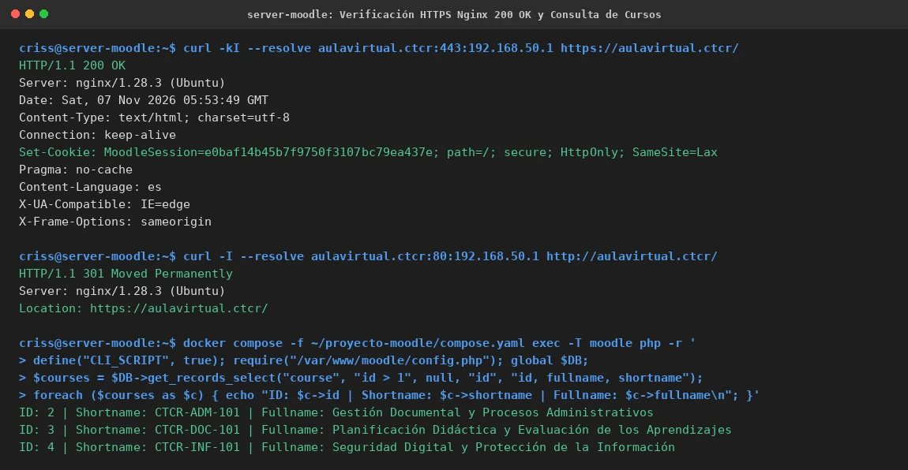

# EV-135 — Verificación HTTPS Nginx 200 OK y Consulta de Cursos

**Procedencia:** Laboratorio EIF431O, Fase Opcional. Captura en VM 1 (Moodle `192.168.56.103`). **Paso relacionado:** [13-04](../../13-04.md).

## Qué ocurre en esta captura

En VM 1 (`criss@server-moodle`):
1. Solicitud `curl -kI --resolve aulavirtual.ctcr:443:192.168.50.1 https://aulavirtual.ctcr/`:
   - `HTTP/1.1 200 OK` emitido por `nginx/1.28.3 (Ubuntu)`.
   - Cookie segura de sesión `MoodleSession` con directivas `secure; HttpOnly; SameSite=Lax`.
2. Solicitud `curl -I --resolve aulavirtual.ctcr:80:192.168.50.1 http://aulavirtual.ctcr/`:
   - `HTTP/1.1 301 Moved Permanently` con redirección hacia `https://aulavirtual.ctcr/`.
3. Ejecución de script CLI en PHP dentro del contenedor Moodle leyendo la base de datos de VM 2:
   - Curso 2: `CTCR-ADM-101` — Gestión Documental y Procesos Administrativos.
   - Curso 3: `CTCR-DOC-101` — Planificación Didáctica y Evaluación de los Aprendizajes.
   - Curso 4: `CTCR-INF-101` — Seguridad Digital y Protección de la Información.

## Interpretación y límite de la evidencia

Certifica que el tráfico HTTPS es procesado adecuadamente por Nginx y derivado hacia Moodle, el cual extrae los cursos y configuraciones directamente desde la máquina remota MariaDB en VM 2. Para demostrar de manera concluyente que Moodle no puede funcionar sin VM 2, se requiere una prueba de corte controlado (EV-136).

## Reproducir y verificar

1. Seguir el procedimiento [13-04](../../13-04.md) en VM 1.
2. Ejecutar los comandos `curl` y la consulta CLI de cursos.

## Identidad, trazabilidad y privacidad

- **Identificador permanente:** `EV-135`.
- **Archivo de imagen:** `EV-135.webp`.
- **SHA-256 de la imagen incorporada:** `c428abc1596b7a96f2091f3a8164461931da401840c85412bbfb4e5112ee4f58`.
- **Origen:** Verificación web y CLI en VM 1, 2026-11-07.
- **VM:** VM 1 (`criss@server-moodle`, `192.168.56.103`).
- **Estado de revisión:** `VERIFICADA, revisada`.
- **Política de privacidad:** Sin credenciales; identificador de sesión rotativo.
