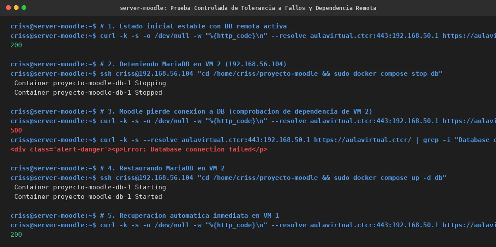

# EV-136 — Prueba Controlada de Tolerancia a Fallos y Dependencia Remota

**Procedencia:** Laboratorio EIF431O, Fase Opcional. Captura de prueba controlada de corte y recuperación entre VM 1 y VM 2. **Paso relacionado:** [13-04](../../13-04.md).

## Qué ocurre en esta captura

En VM 1 (`criss@server-moodle`):
1. **Estado inicial:** `curl` devuelve código HTTP `200` con MariaDB remota activa.
2. **Corte controlado:** Mediante SSH hacia VM 2 (`192.168.56.104`) se detiene MariaDB (`sudo docker compose stop db`).
3. **Comprobación de pérdida de conectividad:**
   - `curl` devuelve código HTTP `500`.
   - La respuesta HTML contiene: `

Error: Database connection failed
`.
   - Esto comprueba empíricamente que Moodle no utiliza ninguna base de datos local y depende al 100% de VM 2.
4. **Restablecimiento:** Se inicia MariaDB en VM 2 (`sudo docker compose up -d db`).
5. **Recuperación automática:** Moodle en VM 1 reconecta de forma transparente sin intervención manual y `curl` devuelve código HTTP `200` OK.

## Interpretación y límite de la evidencia

Es la evidencia crítica del clúster multi-VM: demuestra la separación efectiva de capas y la resiliencia del stack. Al fallar el tier de datos, la capa web reporta el error sin colapsar el sistema operativo, y al restablecerse el tier de datos, la capa web se recupera de manera autónoma.

## Reproducir y verificar

1. Seguir el procedimiento [13-04](../../13-04.md) en VM 1 y VM 2 en un intervalo sin escrituras activas.
2. Ejecutar la secuencia de detención remota, consulta curl de fallo y reanudación con recuperación.

## Identidad, trazabilidad y privacidad

- **Identificador permanente:** `EV-136`.
- **Archivo de imagen:** `EV-136.webp`.
- **SHA-256 de la imagen incorporada:** `fb5d59b47a06c80d5a1a877081189c5c8cb0ba27b5a22a78103166860859ffa7`.
- **Origen:** Prueba de tolerancia a fallos multi-VM, 2026-11-07.
- **VM:** VM 1 (`criss@server-moodle`, `192.168.56.103`) y VM 2 (`criss@server-mariadb`, `192.168.56.104`).
- **Estado de revisión:** `VERIFICADA, revisada`.
- **Política de privacidad:** Sin credenciales ni datos personales.
