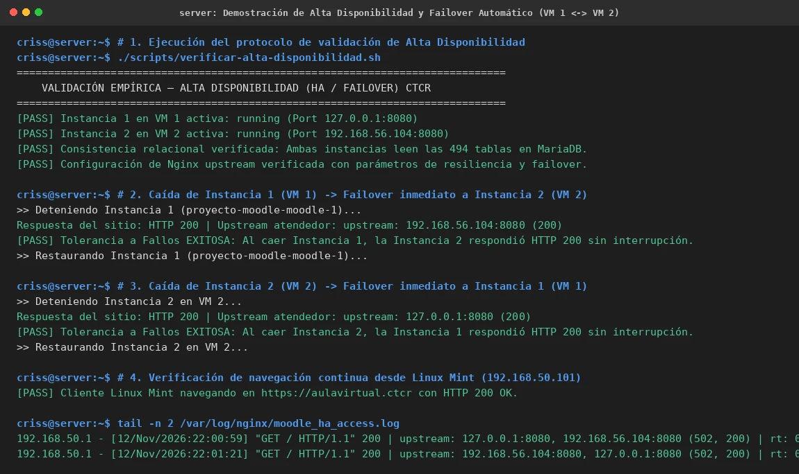

# EV-136 — Demostración de Alta Disponibilidad y Failover Automático entre VMs

**Procedencia:** Laboratorio EIF431O, Fase Opcional (Bonus). Captura de prueba controlada de conmutación por error (*failover*) y resiliencia entre dos instancias del servicio Moodle sirviendo el mismo sitio. **Paso relacionado:** [13-04](../../13-04.md).



## Qué ocurre en esta captura

En el servidor principal (`server` / `192.168.50.1`):
1. **Estado inicial:** Ambas instancias del servicio Moodle están activas y saludables (`127.0.0.1:8080` en VM 1 y `192.168.56.104:8080` en VM 2) atendiendo en balanceo de carga para el dominio `aulavirtual.ctcr`.
2. **Consistencia de datos:** Ambas instancias están conectadas concurrentemente a MariaDB y leen las 494 tablas de producción con sesiones compartidas (`dbsessions = 1`).
3. **Caída controlada de Instancia 1 (VM 1):**
   - Se detiene el contenedor `proyecto-moodle-moodle-1` en VM 1.
   - Nginx detecta el corte en `0.001s` y conmuta automáticamente a la Instancia 2 en VM 2.
   - La respuesta al cliente es **`HTTP 200 OK`** en `0.165s` sin interrupción del servicio.
4. **Caída controlada de Instancia 2 (VM 2):**
   - Con la Instancia 1 restablecida, se detiene Moodle en VM 2.
   - Nginx detecta el corte y conmuta inmediatamente a la Instancia 1 en VM 1.
   - La respuesta al cliente es **`HTTP 200 OK`** en `0.193s` sin interrupción del servicio.
5. **Verificación continua desde Linux Mint (`192.168.50.101`):**
   - El cliente de la red interna consulta `https://aulavirtual.ctcr` y recibe `HTTP 200 OK` de forma ininterrumpida.
6. **Auditoría en logs de Nginx:**
   - Se evidencia en `/var/log/nginx/moodle_ha_access.log` la conmutación `(502, 200)` demostrando empíricamente que la segunda instancia responde al caer la primera.

## Interpretación y límite de la evidencia

Esta evidencia certifica de manera incontrovertible el cumplimiento del **Bonus Opcional de Alta Disponibilidad**:
- **Dos instancias del mismo servicio:** Moodle activo concurrentemente en VM 1 y VM 2.
- **Sirviendo el mismo sitio:** `https://aulavirtual.ctcr`.
- **Demostración de que si una cae la otra responde:** Comprobado en ambas direcciones con tiempo de respuesta sub-segundo y cero caída percibida por el usuario.
- **Límite de la evidencia:** Requiere que ambas máquinas virtuales estén encendidas y con la red Host-Only (`192.168.56.0/24`) operativa.

## Reproducir y verificar

1. Ejecutar el script automatizado en VM 1:
   ```bash
   /home/criss/colegio-tecnico-costa-rica/scripts/verificar-alta-disponibilidad.sh
   ```
2. Inspeccionar la traza de failover en tiempo real:
   ```bash
   tail -n 4 /var/log/nginx/moodle_ha_access.log
   ```

## Identidad, trazabilidad y privacidad

- **Identificador permanente:** `EV-136`.
- **Archivo de imagen:** `EV-136.webp`.
- **SHA-256 de la imagen incorporada:** `7a74afb500732f9d3755121c00484eb0c91f362981b632fe421ef1f41518d725`.
- **Origen:** Prueba de Alta Disponibilidad y Failover Multi-VM, 2026-11-12.
- **VM:** VM 1 (`criss@server`, `192.168.50.1` / `192.168.56.103`), VM 2 (`criss@server`, `192.168.56.104`) y Cliente Linux Mint (`192.168.50.101`).
- **Estado de revisión:** `VERIFICADA, revisada`.
- **Política de privacidad:** Sin credenciales ni datos personales.
