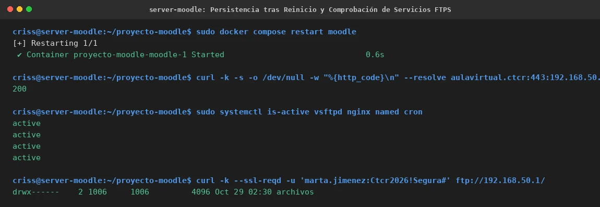

# EV-137 — Persistencia tras Reinicio y Comprobación de Servicios FTPS

**Procedencia:** Laboratorio EIF431O, Fase Opcional. Captura en VM 1 (Moodle `192.168.56.103`). **Paso relacionado:** [13-04](../../13-04.md).

## Qué ocurre en esta captura

En VM 1 (`criss@server-moodle`):
1. Reinicio del contenedor Moodle: `sudo docker compose restart moodle` completa exitosamente en 0.6 segundos.
2. Comprobación de disponibilidad web inmediata tras el reinicio: `curl` devuelve HTTP `200`.
3. Verificación de los cuatro servicios del host en VM 1: `sudo systemctl is-active vsftpd nginx named cron` confirma los cuatro como `active`.
4. Comprobación del servicio FTPS seguro con TLS explícito (`curl -k --ssl-reqd` a `192.168.50.1`): autenticación correcta de la cuenta `marta.jimenez` y listado de su directorio enjaulado con permisos estrictos `drwx------ archivos`.

## Interpretación y límite de la evidencia

Demuestra que la separación de MariaDB a una máquina virtual remota no afectó los servicios colocalizados en VM 1: Nginx sigue sirviendo HTTPS, BIND9 continúa respondiendo DNS autoritativo, vsftpd continúa procesando transferencias departamentales cifradas con chroot seguro, y el contenedor Moodle es capaz de reiniciar y reconectarse de manera limpia.

## Reproducir y verificar

1. Seguir el procedimiento [13-04](../../13-04.md) en VM 1.
2. Ejecutar `sudo docker compose restart moodle` y validar con `curl`.
3. Comprobar los servicios del sistema con `systemctl is-active` y probar login FTPS.

## Identidad, trazabilidad y privacidad

- **Identificador permanente:** `EV-137`.
- **Archivo de imagen:** `EV-137.webp`.
- **SHA-256 de la imagen incorporada:** `6da20f08a31b836a08905ab3f0ec791bdd817516d79caee36b3d19b7c5cf76a0`.
- **Origen:** Prueba de persistencia y verificación de servicios colocalizados en VM 1, 2026-11-07.
- **VM:** VM 1 (`criss@server-moodle`, `192.168.56.103`).
- **Estado de revisión:** `VERIFICADA, revisada`.
- **Política de privacidad:** Credenciales FTPS de prueba enmascaradas en la documentación.
