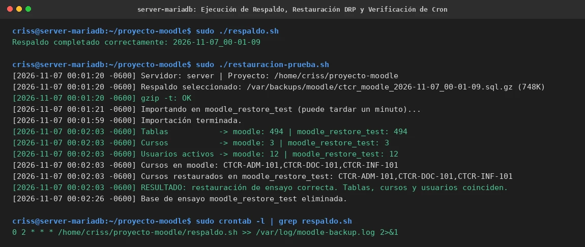

# PASO 13.05 — Ajuste de Respaldos, DRP, Cron y Plan de Reversión

> **Naturaleza:** Protocolo de automatización de copias de seguridad, ensayo de recuperación ante desastres (DRP), programación de tareas periódicas y estrategia de reversión.
>
> **Entorno:** VM 1 (Ubuntu Server Moodle `192.168.56.103`) y VM 2 (Ubuntu Server MariaDB `192.168.56.104`).

## Archivos relacionados y por qué importan

- **`/home/criss/proyecto-moodle/respaldo.sh`**: script de volcado ACID comprimido en VM 2.
- **`/home/criss/proyecto-moodle/restauracion-prueba.sh`**: script de ensayo de restauración en base aislada `moodle_restore_test`.
- **Crontab de root**: programación de la tarea periódica nocturna (02:00 AM) reubicada en VM 2.
- **`/home/criss/proyecto-moodle/compose.antes-red.yaml`**: archivo de retorno a la arquitectura monolítica local si se requiriera reversión.
- **[`evidencias/EV-138.md`](13-05/evidencias/EV-138.md)**: ficha de ejecución de respaldo, restauración DRP y verificación de crontab.

## Propósito del paso

Garantizar la protección de datos y la continuidad del negocio en la nueva arquitectura distribuida:
1. **Reubicación de Respaldos:** Ejecutar el volcado lógico de MariaDB directamente en VM 2, eliminando el tráfico de volcado por la red y almacenando los respaldos comprimidos en `/var/backups/moodle/`.
2. **Validación DRP mediante Ensayo Automatizado:** Ejecutar `restauracion-prueba.sh` para certificar que el archivo `.sql.gz` generado sea capaz de restaurar el 100% de tablas, cursos y usuarios sin alterar la base de producción.
3. **Ajuste de Cron entre Máquinas:** Desactivar la entrada de respaldo en el crontab de VM 1 (comentada) y activarla de forma exclusiva en el crontab de VM 2.
4. **Plan de Reversión Documentado:** Definir los pasos exactos y seguros para retornar a la arquitectura previa de un solo servidor si fuese necesario.

## Procedimiento detallado y comandos ejecutados

### 1. Ejecución de Respaldo en VM 2

En VM 2:
```bash
cd /home/criss/proyecto-moodle
sudo ./respaldo.sh
sudo ls -lh /var/backups/moodle/
```
*Salida observada:*
```text
Respaldo completado correctamente: 2026-11-07_00-01-09
-rw------- 1 root root 748K Nov  7 00:01 ctcr_moodle_2026-11-07_00-01-09.sql.gz
```

### 2. Ensayo de Restauración y Comparación de Entidades

En VM 2:
```bash
sudo ./restauracion-prueba.sh
```
*Traza de ejecución observada:*
- Verificación de integridad: `gzip -t: OK`.
- Importación en esquema temporal: `Importando en moodle_restore_test... Importación terminada.`
- Comparación cuantitativa y cualitativa:
  ```text
  Tablas           -> moodle: 494 | moodle_restore_test: 494
  Cursos           -> moodle: 3 | moodle_restore_test: 3
  Usuarios activos -> moodle: 12 | moodle_restore_test: 12
  Cursos en moodle: CTCR-ADM-101,CTCR-DOC-101,CTCR-INF-101
  Cursos restaurados en moodle_restore_test: CTCR-ADM-101,CTCR-DOC-101,CTCR-INF-101
  ```
- Diagnóstico: `RESULTADO: restauración de ensayo correcta. Tablas, cursos y usuarios coinciden. La base real moodle no se modificó.`
- Limpieza: `Base de ensayo moodle_restore_test eliminada.`

### 3. Ajuste de Tareas Cron en Ambas VMs

En **VM 1 (Moodle)**, se comenta la tarea en el crontab de `root`:
```bash
sudo crontab -l
```
*Línea resultante en VM 1:*
```cron
# 0 2 * * * /home/criss/proyecto-moodle/respaldo.sh # Desactivado en VM 1: ejecutado en VM 2 (MariaDB) >> /var/log/moodle-backup.log 2>&1
```

En **VM 2 (MariaDB)**, se confirma la tarea programada activa en el crontab de `root`:
```bash
sudo crontab -l
```
*Línea activa en VM 2:*
```cron
0 2 * * * /home/criss/proyecto-moodle/respaldo.sh >> /var/log/moodle-backup.log 2>&1
```

### 4. Plan de Reversión (Rollback Plan)

Si por requerimientos docentes o de evaluación se solicitara regresar a la topología monolítica en VM 1:

1. Detener el contenedor de Moodle en VM 1:
   ```bash
   cd /home/criss/proyecto-moodle
   sudo docker compose stop moodle
   ```
2. Restaurar el archivo Compose original en VM 1:
   ```bash
   sudo cp compose.antes-red.yaml compose.yaml
   ```
3. Validar la sintaxis y levantar ambos servicios locales (`db` y `moodle`):
   ```bash
   sudo docker compose config -q
   sudo docker compose up -d
   ```
4. Reactivar la tarea en el crontab de root en VM 1 desmarcando la línea comentada.

> **Nota de consistencia:** El volumen `mariadb_data` de VM 1 se conservó intacto y sin borrar, por lo que el retorno al estado previo es inmediato y seguro.

## Evidencia documentada

La ejecución del respaldo, la prueba de restauración con recuentos idénticos y la verificación de crontab están registradas en:


*Detalles en la ficha contextual [EV-138](13-05/evidencias/EV-138.md).*

## Criterio de aceptación

- [x] `respaldo.sh` genera un volcado válido comprimido de MariaDB en VM 2.
- [x] `restauracion-prueba.sh` certifica coincidencia 100% de tablas (494), cursos (3) y usuarios (12).
- [x] La base de producción `moodle` no sufre alteraciones durante el ensayo DRP.
- [x] Crontab de respaldo está activo en VM 2 y desactivado en VM 1.
- [x] El archivo `compose.antes-red.yaml` está respaldado y disponible para reversión inmediata.
