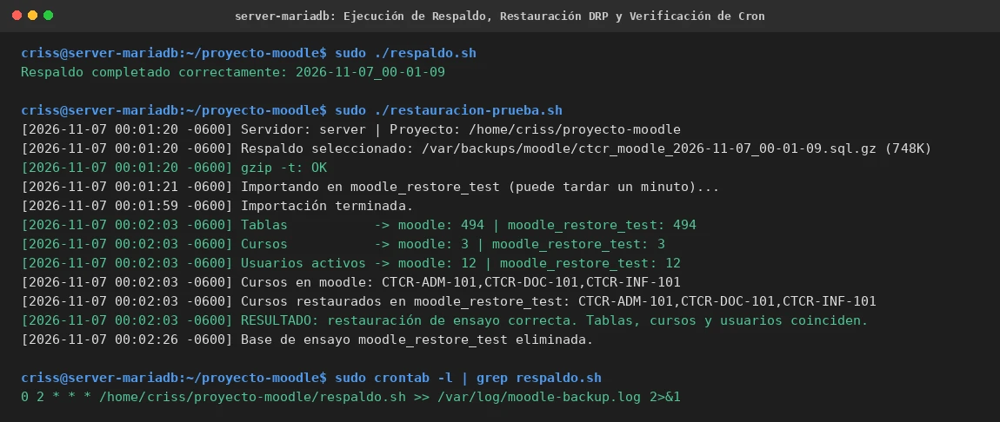

# EV-138 — Ejecución de Respaldo, Restauración DRP y Verificación de Cron

**Procedencia:** Laboratorio EIF431O, Fase Opcional. Captura en VM 2 (MariaDB `192.168.56.104`). **Paso relacionado:** [13-05](../../13-05.md).

## Qué ocurre en esta captura

En VM 2 (`criss@server-mariadb`):
1. Ejecución del script oficial de respaldo: `sudo ./respaldo.sh` finaliza con `Respaldo completado correctamente: 2026-11-07_00-01-09` generando el archivo `ctcr_moodle_2026-11-07_00-01-09.sql.gz` (748 KB) en `/var/backups/moodle/`.
2. Ejecución del script de restauración de ensayo: `sudo ./restauracion-prueba.sh`:
   - Verificación de compresión: `gzip -t: OK`.
   - Importación completa en base temporal `moodle_restore_test`.
   - Comparación de entidades:
     - Tablas: `moodle: 494 | moodle_restore_test: 494`.
     - Cursos: `moodle: 3 | moodle_restore_test: 3`.
     - Usuarios activos: `moodle: 12 | moodle_restore_test: 12`.
     - Nombres de cursos: `CTCR-ADM-101,CTCR-DOC-101,CTCR-INF-101` coincidentes 100%.
   - Resultado: `RESULTADO: restauración de ensayo correcta. Tablas, cursos y usuarios coinciden. La base real moodle no se modificó.`
   - Limpieza automática: `Base de ensayo moodle_restore_test eliminada.`
3. Verificación de programación Cron en VM 2: confirmación de la tarea programada activa `0 2 * * * /home/criss/proyecto-moodle/respaldo.sh >> /var/log/moodle-backup.log 2>&1`.

## Interpretación y límite de la evidencia

Demuestra que la estrategia de respaldos automatizados y el plan de recuperación ante desastres (DRP) fueron transferidos con éxito a la máquina de base de datos (VM 2), donde reside el contenedor relacional. El respaldo se genera en caliente sin bloquear lecturas, se verifica contra corrupción y se comprueba mediante un ciclo de restauración completo.

## Reproducir y verificar

1. Seguir el procedimiento [13-05](../../13-05.md) en VM 2.
2. Ejecutar `sudo ./respaldo.sh` y luego `sudo ./restauracion-prueba.sh`.
3. Validar las tareas de crontab con `sudo crontab -l`.

## Identidad, trazabilidad y privacidad

- **Identificador permanente:** `EV-138`.
- **Archivo de imagen:** `EV-138.webp`.
- **SHA-256 de la imagen incorporada:** `e6e970273a8b3a885aaa64ecb24939bbf333776429ea9596036a9885cf432678`.
- **Origen:** Prueba de respaldos y recuperación DRP en VM 2, 2026-11-07.
- **VM:** VM 2 (`criss@server-mariadb`, `192.168.56.104`).
- **Estado de revisión:** `VERIFICADA, revisada`.
- **Política de privacidad:** Contraseña inyectada de forma no interactiva sin exposición de credenciales.
