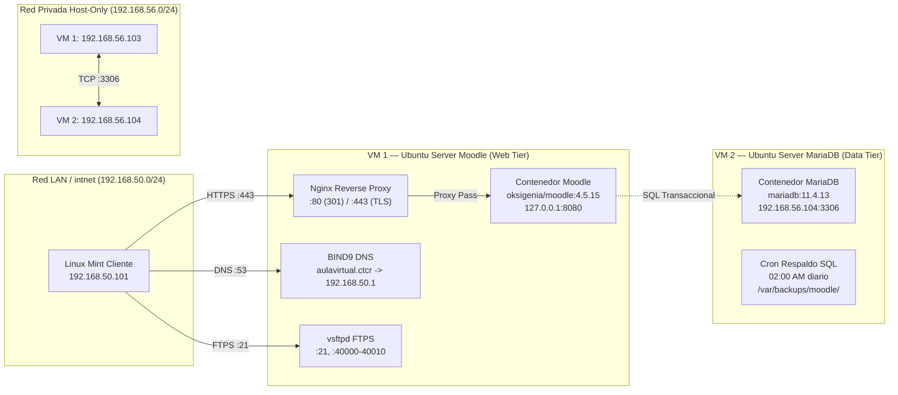

# Capítulo 13 — Fase Opcional: Arquitectura Distribuida Multi-VM (Separación de Moodle y MariaDB)

Este capítulo documenta la implementación completa, verificación y aseguramiento operativo de la **Fase Opcional** del proyecto final del Colegio Técnico de Costa Rica (CTCR). En esta fase, la infraestructura evoluciona de un modelo monolítico en una sola máquina virtual hacia una **arquitectura distribuida de dos niveles (two-tier architecture)** sobre dos clones de Ubuntu Server interconectados mediante una red privada Host-Only.

## Resumen de Máquinas y Roles

| Parámetro | VM 1 — Moodle (Web Tier) | VM 2 — MariaDB (Data Tier) |
|---|---|---|
| **Hostname** | `server` (Moodle) | `server` (MariaDB) |
| **Usuario / Sudo** | `criss` / `NOPASSWD` | `criss` / `NOPASSWD` |
| **Interfaz WAN (NAT)** | `enp0s3` (`10.0.2.15/24`) | `enp0s3` (`10.0.2.15/24`) |
| **Interfaz LAN (`intnet`)** | `enp0s8` (`192.168.50.1/24`) | Desactivada (para evitar colisión de IP con `192.168.50.1`) |
| **Interfaz Host-Only** | `enp0s9` (`192.168.56.103/24`) | `enp0s9` (`192.168.56.104/24`) |
| **Servicios Activos** | Nginx, BIND9, vsftpd, Docker (Moodle) | Docker (MariaDB), Cron de respaldo |
| **Puertos de Red** | `:80`, `:443`, `:53`, `:21`, `40000:40010` | `192.168.56.104:3306` (aislado) |
| **Ruta del Proyecto** | `/home/criss/proyecto-moodle/` | `/home/criss/proyecto-moodle/` |

## Subpasos del Capítulo

| Subpaso | Título y Enlace | Propósito Operativo | Evidencias |
|---|---|---|:---:|
| **13.01** | [Configuración de Red e Interfaces Netplan](13-01.md) | Asignación estática de IPs en `192.168.56.0/24` y comprobación de ping bidireccional. | [EV-131](13-01/evidencias/EV-131.md) |
| **13.02** | [Aislamiento y Preparación de MariaDB en VM 2](13-02.md) | Enlace exclusivo a `192.168.56.104:3306`, detención de Moodle/host y auditoría de tablas. | [EV-132](13-02/evidencias/EV-132.md), [EV-133](13-02/evidencias/EV-133.md) |
| **13.03** | [Conexión de Moodle en VM 1 a MariaDB Remota](13-03.md) | Configuración de `MOODLE_DB_HOST: 192.168.56.104`, arranque de Moodle y verificación de `config.php`. | [EV-134](13-03/evidencias/EV-134.md) |
| **13.04** | [Verificación Funcional, Tolerancia a Fallos y FTPS](13-04.md) | Checklist de 8 puntos, consulta de cursos, prueba controlada de corte/recuperación y FTPS. | [EV-135](13-04/evidencias/EV-135.md), [EV-136](13-04/evidencias/EV-136.md), [EV-137](13-04/evidencias/EV-137.md) |
| **13.05** | [Ajuste de Respaldos, DRP, Cron y Reversión](13-05.md) | Ejecución de `respaldo.sh` y `restauracion-prueba.sh` en VM 2, reubicación de Cron y plan de rollback. | [EV-138](13-05/evidencias/EV-138.md) |

## Criterios de Aceptación del Bloque

1. **Aislamiento de Red:** La base de datos MariaDB no expone ningún puerto hacia la red LAN institucional ni hacia Internet; escucha de forma exclusiva en la IP privada Host-Only `192.168.56.104:3306`.
2. **Preservación Íntegra de Datos:** Las 494 tablas de Moodle, los 12 usuarios y los 3 cursos departamentales se conservan intactos.
3. **Desacoplamiento Efectivo:** Se comprueba empíricamente la dependencia mediante corte controlado (al detener MariaDB en VM 2, Moodle reporta HTTP 500 con error de base de datos; al restablecerla, Moodle recupera HTTP 200 de inmediato).
4. **Continuidad de Servicios del Host:** Nginx TLS, BIND9 y vsftpd con enjaulamiento departamental 700 siguen operando sin interrupción en VM 1.
5. **Autonomía de Respaldos:** Las copias de seguridad de la base de datos y su ciclo de ensayo de restauración operan localmente en VM 2 mediante Cron.
