# Catálogo maestro de evidencias históricas — CTCR / Elevaquitas

> Este catálogo es un **índice**, no un depósito de imágenes. Cada captura reside en `docs/procedimientos/<fase>/<paso>/evidencias/` junto al paso al que pertenece, con ficha propia, explicación, origen y límites probatorios.

## Cómo interpretar las evidencias

Una captura de una interfaz muestra que se abrió o editó esa pantalla, pero no verifica automáticamente persistencia, autorización, seguridad ni reproducibilidad en cinco VMs. La validación de aceptación requiere resultados observados de las pruebas definidas en cada paso.

## Ubicación y significado de las 99 capturas (EV-001 a EV-099)

### [01-01 — PASO 01.01 — Topología NAT e interna y verificación entre Ubuntu y Mint](../docs/procedimientos/01-servidor-red/01-01.md)

- **[EV-001 — Mint: ping hacia Ubuntu Server](../docs/procedimientos/01-servidor-red/01-01/evidencias/EV-001.md)** (p. 2): La terminal de Linux Mint recibe respuestas ICMP de la IP interna de Ubuntu; evidencia una ruta de red en esa VM. **Limitación:** No certifica el resultado en las cinco VMs ni el cumplimiento del resto de requisitos.
- **[EV-002 — Ubuntu: ping hacia Mint](../docs/procedimientos/01-servidor-red/01-01/evidencias/EV-002.md)** (p. 2): Ubuntu recibe respuestas ICMP desde Linux Mint; se observa comunicación de retorno en la red de laboratorio. **Limitación:** No certifica el resultado en las cinco VMs ni el cumplimiento del resto de requisitos.
- **[EV-003 — Ubuntu: conectividad exterior](../docs/procedimientos/01-servidor-red/01-01/evidencias/EV-003.md)** (p. 3): Ubuntu muestra respuestas de un nombre público; es evidencia puntual de conectividad/resolución saliente. **Limitación:** No certifica el resultado en las cinco VMs ni el cumplimiento del resto de requisitos.

### [01-02 — PASO 01.02 — Estado de discos, LVM y recuperación del incidente histórico](../docs/procedimientos/01-servidor-red/01-02.md)

- **[EV-050 — Diagnóstico de disco lleno y ampliación LVM](../docs/procedimientos/01-servidor-red/01-02/evidencias/EV-050.md)** (p. 25): Se observa el diagnóstico de espacio, el estado LVM y comandos ejecutados para ampliar la raíz; corresponde al incidente INC-001. **Limitación:** No autoriza replicar cambios LVM en otra VM: requiere comprobar volumen, filesystem y copia de seguridad del equipo concreto.

### [04-02 — PASO 04.02 — Confirmar las versiones de las imágenes](../docs/procedimientos/04-contenedores/04-02.md)

- **[EV-004 — Etiquetas de las imágenes Docker verificadas](../docs/procedimientos/04-contenedores/04-02/evidencias/EV-004.md)** (p. 3): La terminal devuelve disponibilidad de las etiquetas solicitadas en el registro de imágenes. **Limitación:** No certifica que todos los integrantes tengan la misma versión/digest, salud estable o persistencia de datos.

### [04-03 — PASO 04.03 — Generar las contraseñas](../docs/procedimientos/04-contenedores/04-03.md)

- **[EV-005 — OpenSSL: generación del archivo privado .env](../docs/procedimientos/04-contenedores/04-03/evidencias/EV-005.md)** (p. 3): Se ven los comandos para generar el archivo privado .env y consultar OpenSSL; no se presenta su contenido. **Limitación:** No certifica que todos los integrantes tengan la misma versión/digest, salud estable o persistencia de datos.
- **[EV-006 — Protección de permisos del .env](../docs/procedimientos/04-contenedores/04-03/evidencias/EV-006.md)** (p. 3): Se aplica chmod 600 al .env; la captura no muestra una comprobación posterior con stat. **Limitación:** No certifica que todos los integrantes tengan la misma versión/digest, salud estable o persistencia de datos.

### [04-04 — PASO 04.04 — Crear el archivo Compose](../docs/procedimientos/04-contenedores/04-04.md)

- **[EV-007 — Primer bloque de configuración Compose](../docs/procedimientos/04-contenedores/04-04/evidencias/EV-007.md)** (p. 4): Se observa el archivo compose.yaml abierto en un editor; es evidencia de edición, no de sintaxis válida ni de ejecución. **Limitación:** No certifica que todos los integrantes tengan la misma versión/digest, salud estable o persistencia de datos.
- **[EV-008 — Segundo bloque de configuración Compose](../docs/procedimientos/04-contenedores/04-04/evidencias/EV-008.md)** (p. 5): Se observa el archivo compose.yaml abierto en un editor; es evidencia de edición, no de sintaxis válida ni de ejecución. **Limitación:** No certifica que todos los integrantes tengan la misma versión/digest, salud estable o persistencia de datos.

### [04-06 — PASO 04.06 — Descargar las imágenes](../docs/procedimientos/04-contenedores/04-06.md)

- **[EV-009 — Compose config, pull e imágenes](../docs/procedimientos/04-contenedores/04-06/evidencias/EV-009.md)** (p. 6): Se observa la secuencia de configuración y descarga de imágenes; confirma actividad en la terminal de esta VM. **Limitación:** No certifica que todos los integrantes tengan la misma versión/digest, salud estable o persistencia de datos.

### [04-07 — PASO 04.07 — Levantar los contenedores](../docs/procedimientos/04-contenedores/04-07.md)

- **[EV-010 — docker compose up y estado de los servicios](../docs/procedimientos/04-contenedores/04-07/evidencias/EV-010.md)** (p. 6): Se observa la creación/inicio de servicios y el listado de Compose; refleja un inicio de los contenedores. **Limitación:** No certifica que todos los integrantes tengan la misma versión/digest, salud estable o persistencia de datos.
- **[EV-011 — Registros iniciales de MariaDB](../docs/procedimientos/04-contenedores/04-07/evidencias/EV-011.md)** (p. 6): Se muestran logs del arranque/inicialización; sirven para explicar el proceso y diagnosticar errores de la primera ejecución. **Limitación:** No certifica que todos los integrantes tengan la misma versión/digest, salud estable o persistencia de datos.
- **[EV-012 — Registros de instalación de Moodle](../docs/procedimientos/04-contenedores/04-07/evidencias/EV-012.md)** (p. 6): Se muestran logs del arranque/inicialización; sirven para explicar el proceso y diagnosticar errores de la primera ejecución. **Limitación:** No certifica que todos los integrantes tengan la misma versión/digest, salud estable o persistencia de datos.

### [04-08 — PASO 04.08 — Confirmar la base de datos](../docs/procedimientos/04-contenedores/04-08.md)

- **[EV-013 — Inicio de sesión en MariaDB con credenciales del .env](../docs/procedimientos/04-contenedores/04-08/evidencias/EV-013.md)** (p. 7): Se observa el cliente MariaDB abierto contra la base moodle; la línea con credencial fue ocultada. **Limitación:** No certifica que todos los integrantes tengan la misma versión/digest, salud estable o persistencia de datos.
- **[EV-014 — Consulta SHOW TABLES de Moodle](../docs/procedimientos/04-contenedores/04-08/evidencias/EV-014.md)** (p. 7): SHOW TABLES enumera tablas con prefijo mdl_; confirma que existe un esquema Moodle inicializado en esa base. **Limitación:** No certifica que todos los integrantes tengan la misma versión/digest, salud estable o persistencia de datos.

### [04-09 — PASO 04.09 — Verificar los volúmenes](../docs/procedimientos/04-contenedores/04-09.md)

- **[EV-015 — Persistencia: docker volume ls](../docs/procedimientos/04-contenedores/04-09/evidencias/EV-015.md)** (p. 7): docker volume ls enumera los tres volúmenes esperados; prueba existencia de volúmenes, no integridad de sus contenidos. **Limitación:** No certifica que todos los integrantes tengan la misma versión/digest, salud estable o persistencia de datos.

### [05-02 — PASO 05.02 — Abrir Moodle desde Mint](../docs/procedimientos/05-cliente-mint/05-02.md)

- **[EV-016 — Pantalla inicial de Moodle](../docs/procedimientos/05-cliente-mint/05-02/evidencias/EV-016.md)** (p. 8): Se muestra la pantalla de inicio de sesión Moodle accesible desde el navegador. **Limitación:** No certifica el resultado en las cinco VMs ni el cumplimiento del resto de requisitos.
- **[EV-017 — Perfil del administrador Moodle](../docs/procedimientos/05-cliente-mint/05-02/evidencias/EV-017.md)** (p. 8): Se observa una pantalla autenticada del perfil administrativo Moodle; los datos privados deben revisarse antes de publicación. **Limitación:** No certifica el resultado en las cinco VMs ni el cumplimiento del resto de requisitos.

### [05-03 — PASO 05.03 — Probar la persistencia](../docs/procedimientos/05-cliente-mint/05-03.md)

- **[EV-018 — Recreación de contenedores para comprobar persistencia](../docs/procedimientos/05-cliente-mint/05-03/evidencias/EV-018.md)** (p. 8): Se observa la bajada y subida de servicios Docker; acredita ejecución de la maniobra de recreación. **Limitación:** No prueba por sí sola que después de reiniciar siguen los recursos cargados y la base íntegra; requiere una comprobación funcional adicional.

### [06-01 — PASO 06.01 — Personalizar la plataforma](../docs/procedimientos/06-moodle/06-01.md)

- **[EV-019 — Ajustes de la portada de Moodle](../docs/procedimientos/06-moodle/06-01/evidencias/EV-019.md)** (p. 9): Se observa en Moodle la pantalla correspondiente a «Ajustes de la portada de Moodle»; evidencia que el grupo navegó/configuró esta sección del LMS. **Limitación:** No valida por sí sola todos los cursos, rol de profesor, políticas de seguridad ni separación de accesos.
- **[EV-045 — Navegación a personalización](../docs/procedimientos/06-moodle/06-01/evidencias/EV-045.md)** (p. 21): Se observa en Moodle la pantalla correspondiente a «Navegación a personalización»; evidencia que el grupo navegó/configuró esta sección del LMS. **Limitación:** No valida por sí sola todos los cursos, rol de profesor, políticas de seguridad ni separación de accesos.
- **[EV-046 — Opción de editar la página principal](../docs/procedimientos/06-moodle/06-01/evidencias/EV-046.md)** (p. 22): Se observa en Moodle la pantalla correspondiente a «Opción de editar la página principal»; evidencia que el grupo navegó/configuró esta sección del LMS. **Limitación:** No valida por sí sola todos los cursos, rol de profesor, políticas de seguridad ni separación de accesos.
- **[EV-047 — Información institucional del Colegio](../docs/procedimientos/06-moodle/06-01/evidencias/EV-047.md)** (p. 22): Se observa en Moodle la pantalla correspondiente a «Información institucional del Colegio»; evidencia que el grupo navegó/configuró esta sección del LMS. **Limitación:** No valida por sí sola todos los cursos, rol de profesor, políticas de seguridad ni separación de accesos.
- **[EV-048 — Administración del sitio](../docs/procedimientos/06-moodle/06-01/evidencias/EV-048.md)** (p. 23): Se observa en Moodle la pantalla correspondiente a «Administración del sitio»; evidencia que el grupo navegó/configuró esta sección del LMS. **Limitación:** No valida por sí sola todos los cursos, rol de profesor, políticas de seguridad ni separación de accesos.
- **[EV-049 — Menú de apariencia de Moodle](../docs/procedimientos/06-moodle/06-01/evidencias/EV-049.md)** (p. 23): Se observa en Moodle la pantalla correspondiente a «Menú de apariencia de Moodle»; evidencia que el grupo navegó/configuró esta sección del LMS. **Limitación:** No valida por sí sola todos los cursos, rol de profesor, políticas de seguridad ni separación de accesos.
- **[EV-051 — Personalización de la portada institucional](../docs/procedimientos/06-moodle/06-01/evidencias/EV-051.md)**: Portada principal mostrando «Colegio Técnico de Costa Rica», tema Boost corporativo y catálogo de cursos.

  

### [06-02 — PASO 06.02 — Crear las categorías de cursos](../docs/procedimientos/06-moodle/06-02.md)

- **[EV-020 — Categorías de Administración, Docencia e Informática](../docs/procedimientos/06-moodle/06-02/evidencias/EV-020.md)** (p. 9): Se observa en Moodle la pantalla correspondiente a «Categorías de Administración, Docencia e Informática»; evidencia que el grupo navegó/configuró esta sección del LMS. **Limitación:** No valida por sí sola todos los cursos, rol de profesor, políticas de seguridad ni separación de accesos.
- **[EV-052 — Categorías departamentales creadas en Moodle](../docs/procedimientos/06-moodle/06-02/evidencias/EV-052.md)**: Estructura de Administración (DEP-ADM), Docencia (DEP-DOC) e Informática (DEP-INF).

  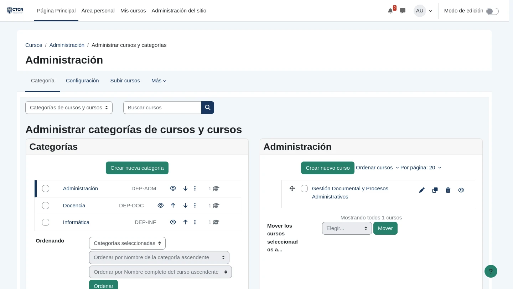

### [06-03 — PASO 06.03 — Crear los tres cursos](../docs/procedimientos/06-moodle/06-03.md)

- **[EV-021 — Gestión de cursos en Moodle](../docs/procedimientos/06-moodle/06-03/evidencias/EV-021.md)** (p. 10): Se observa en Moodle la pantalla correspondiente a «Gestión de cursos en Moodle»; evidencia que el grupo navegó/configuró esta sección del LMS. **Limitación:** No valida por sí sola todos los cursos, rol de profesor, políticas de seguridad ni separación de accesos.
- **[EV-022 — Edición del curso de Docencia](../docs/procedimientos/06-moodle/06-03/evidencias/EV-022.md)** (p. 10): Se observa en Moodle la pantalla correspondiente a «Edición del curso de Docencia»; evidencia que el grupo navegó/configuró esta sección del LMS. **Limitación:** No valida por sí sola todos los cursos, rol de profesor, políticas de seguridad ni separación de accesos.
- **[EV-053 — Cursos institucionales asignados a sus categorías](../docs/procedimientos/06-moodle/06-03/evidencias/EV-053.md)**: Cursos CTCR-ADM-101, CTCR-DOC-101 y CTCR-INF-101 correctamente clasificados.

  

- **[EV-075 — «Mis cursos» con los tres cursos departamentales](../docs/procedimientos/06-moodle/06-03/evidencias/EV-075.md)** (p. 25): Página «Mis cursos» (`my/courses.php`) del administrador con tres tarjetas: «Gestión Documental y Procesos Administrativos» (categoría Administración), «Planificación Didáctica y Evaluación de los Aprendizajes» (Docencia) y «Seguridad Digital y Protección de la Información» (Informática).

  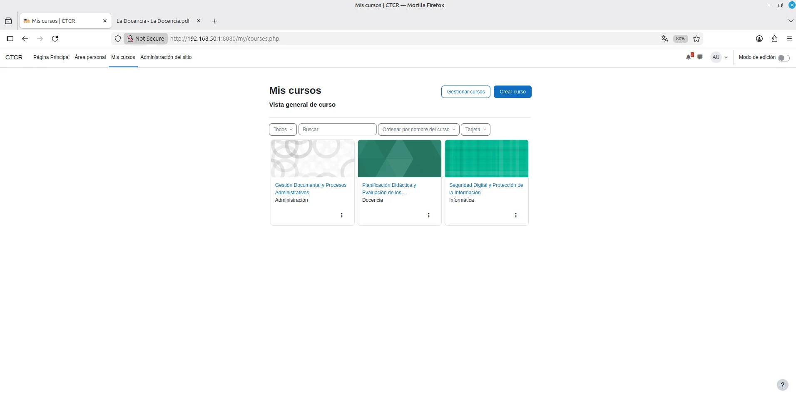

### [06-04 — PASO 06.04 — Agregar los recursos y actividades](../docs/procedimientos/06-moodle/06-04.md)

- **[EV-023 — Edición del curso de Informática](../docs/procedimientos/06-moodle/06-04/evidencias/EV-023.md)** (p. 10): Se observa en Moodle la pantalla correspondiente a «Edición del curso de Informática»; evidencia que el grupo navegó/configuró esta sección del LMS. **Limitación:** No confirma por sí sola dos recursos genuinos y una actividad evaluable terminada en cada uno de los tres cursos, ni un intento de estudiante calificado.
- **[EV-024 — Selector de tipo de recurso](../docs/procedimientos/06-moodle/06-04/evidencias/EV-024.md)** (p. 11): Se observa en Moodle la pantalla correspondiente a «Selector de tipo de recurso»; evidencia que el grupo navegó/configuró esta sección del LMS. **Limitación:** No confirma por sí sola dos recursos genuinos y una actividad evaluable terminada en cada uno de los tres cursos, ni un intento de estudiante calificado.
- **[EV-025 — Carga de recurso PDF en Moodle](../docs/procedimientos/06-moodle/06-04/evidencias/EV-025.md)** (p. 11): Se observa en Moodle la pantalla correspondiente a «Carga de recurso PDF en Moodle»; evidencia que el grupo navegó/configuró esta sección del LMS. **Limitación:** No confirma por sí sola dos recursos genuinos y una actividad evaluable terminada en cada uno de los tres cursos, ni un intento de estudiante calificado.
- **[EV-026 — Secciones del curso de Informática](../docs/procedimientos/06-moodle/06-04/evidencias/EV-026.md)** (p. 12): Se observa en Moodle la pantalla correspondiente a «Secciones del curso de Informática»; evidencia que el grupo navegó/configuró esta sección del LMS. **Limitación:** No confirma por sí sola dos recursos genuinos y una actividad evaluable terminada en cada uno de los tres cursos, ni un intento de estudiante calificado.
- **[EV-027 — Selector de actividades para cuestionario](../docs/procedimientos/06-moodle/06-04/evidencias/EV-027.md)** (p. 12): Se observa en Moodle la pantalla correspondiente a «Selector de actividades para cuestionario»; evidencia que el grupo navegó/configuró esta sección del LMS. **Limitación:** No confirma por sí sola dos recursos genuinos y una actividad evaluable terminada en cada uno de los tres cursos, ni un intento de estudiante calificado.
- **[EV-028 — Configuración del cuestionario y puntuación](../docs/procedimientos/06-moodle/06-04/evidencias/EV-028.md)** (p. 13): Se observa en Moodle la pantalla correspondiente a «Configuración del cuestionario y puntuación»; evidencia que el grupo navegó/configuró esta sección del LMS. **Limitación:** No confirma por sí sola dos recursos genuinos y una actividad evaluable terminada en cada uno de los tres cursos, ni un intento de estudiante calificado.
- **[EV-029 — Cuestionario creado en el curso](../docs/procedimientos/06-moodle/06-04/evidencias/EV-029.md)** (p. 13): Se observa en Moodle la pantalla correspondiente a «Cuestionario creado en el curso»; evidencia que el grupo navegó/configuró esta sección del LMS. **Limitación:** No confirma por sí sola dos recursos genuinos y una actividad evaluable terminada en cada uno de los tres cursos, ni un intento de estudiante calificado.
- **[EV-030 — Pestaña de preguntas del cuestionario](../docs/procedimientos/06-moodle/06-04/evidencias/EV-030.md)** (p. 14): Se observa en Moodle la pantalla correspondiente a «Pestaña de preguntas del cuestionario»; evidencia que el grupo navegó/configuró esta sección del LMS. **Limitación:** No confirma por sí sola dos recursos genuinos y una actividad evaluable terminada en cada uno de los tres cursos, ni un intento de estudiante calificado.
- **[EV-031 — Añadir pregunta al cuestionario](../docs/procedimientos/06-moodle/06-04/evidencias/EV-031.md)** (p. 14): Se observa en Moodle la pantalla correspondiente a «Añadir pregunta al cuestionario»; evidencia que el grupo navegó/configuró esta sección del LMS. **Limitación:** No confirma por sí sola dos recursos genuinos y una actividad evaluable terminada en cada uno de los tres cursos, ni un intento de estudiante calificado.
- **[EV-032 — Selector de tipo de pregunta](../docs/procedimientos/06-moodle/06-04/evidencias/EV-032.md)** (p. 15): Se observa en Moodle la pantalla correspondiente a «Selector de tipo de pregunta»; evidencia que el grupo navegó/configuró esta sección del LMS. **Limitación:** No confirma por sí sola dos recursos genuinos y una actividad evaluable terminada en cada uno de los tres cursos, ni un intento de estudiante calificado.
- **[EV-033 — Formulario de pregunta de opción múltiple](../docs/procedimientos/06-moodle/06-04/evidencias/EV-033.md)** (p. 15): Se observa en Moodle la pantalla correspondiente a «Formulario de pregunta de opción múltiple»; evidencia que el grupo navegó/configuró esta sección del LMS. **Limitación:** No confirma por sí sola dos recursos genuinos y una actividad evaluable terminada en cada uno de los tres cursos, ni un intento de estudiante calificado.
- **[EV-034 — Opciones de respuesta](../docs/procedimientos/06-moodle/06-04/evidencias/EV-034.md)** (p. 16): Se observa en Moodle la pantalla correspondiente a «Opciones de respuesta»; evidencia que el grupo navegó/configuró esta sección del LMS. **Limitación:** No confirma por sí sola dos recursos genuinos y una actividad evaluable terminada en cada uno de los tres cursos, ni un intento de estudiante calificado.
- **[EV-035 — Ponderación de respuesta correcta](../docs/procedimientos/06-moodle/06-04/evidencias/EV-035.md)** (p. 16): Se observa en Moodle la pantalla correspondiente a «Ponderación de respuesta correcta»; evidencia que el grupo navegó/configuró esta sección del LMS. **Limitación:** No confirma por sí sola dos recursos genuinos y una actividad evaluable terminada en cada uno de los tres cursos, ni un intento de estudiante calificado.
- **[EV-036 — Vista del cuestionario creado](../docs/procedimientos/06-moodle/06-04/evidencias/EV-036.md)** (p. 17): Se observa en Moodle la pantalla correspondiente a «Vista del cuestionario creado»; evidencia que el grupo navegó/configuró esta sección del LMS. **Limitación:** No confirma por sí sola dos recursos genuinos y una actividad evaluable terminada en cada uno de los tres cursos, ni un intento de estudiante calificado.
- **[EV-037 — Vista del cuestionario después de crear las preguntas](../docs/procedimientos/06-moodle/06-04/evidencias/EV-037.md)** (p. 17): Se observa en Moodle la pantalla correspondiente a «Vista del cuestionario después de crear las preguntas»; evidencia que el grupo navegó/configuró esta sección del LMS. **Limitación:** No confirma por sí sola dos recursos genuinos y una actividad evaluable terminada en cada uno de los tres cursos, ni un intento de estudiante calificado.
- **[EV-054 — Estructura académica de tres secciones en Informática](../docs/procedimientos/06-moodle/06-04/evidencias/EV-054.md)**: Curso CTCR-INF-101 con PDF institucional, Página interactiva y Cuestionario.

  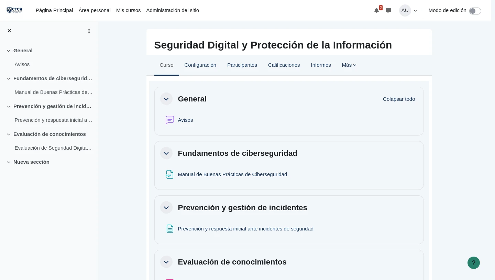

- **[EV-055 — Configuración y banco de preguntas del cuestionario](../docs/procedimientos/06-moodle/06-04/evidencias/EV-055.md)**: Cuestionario con 5 preguntas a 20 pts (100 total) y aprobación en 70.

  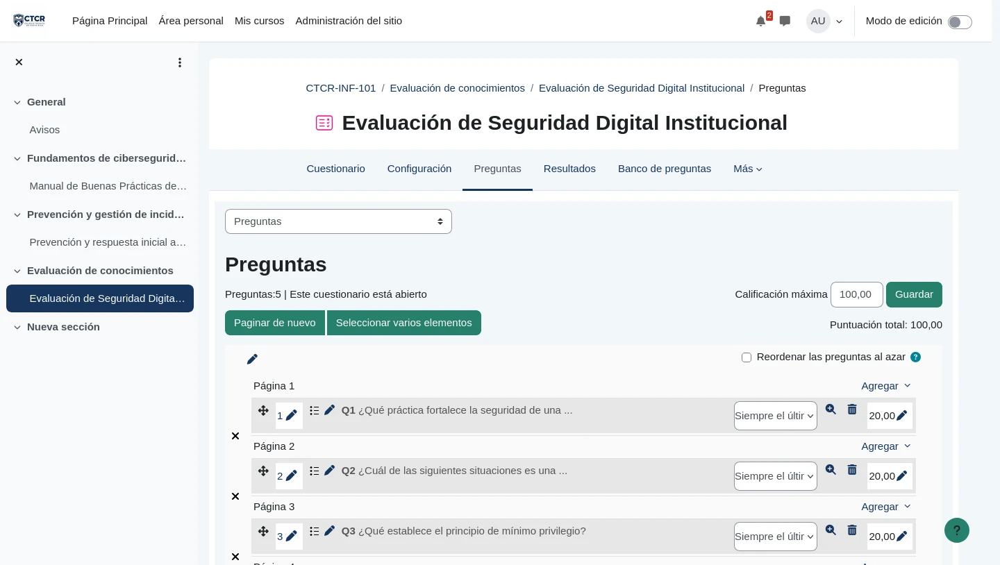

### [06-05 — PASO 06.05 — Crear los usuarios de prueba](../docs/procedimientos/06-moodle/06-05.md)

- **[EV-038 — Formulario «Crear un nuevo usuario»](../docs/procedimientos/06-moodle/06-05/evidencias/EV-038.md)** (p. 18): Formulario vacío de Moodle en `user/editadvanced.php?id=-1` (sitio todavía llamado «Colegio Tecnico»). Se ven los campos que hay que llenar para cada cuenta: nombre de usuario, método de identificación «Cuentas manuales», casilla «Generar contraseña y notificar al usuario», nueva contraseña con su política (mínimo 8 caracteres, 1 dígito, 1 minúscula, 1 mayúscula y 1 carácter especial), «Forzar cambio de contraseña», nombre, apellidos y dirección de correo.
- **[EV-039 — Lista de usuarios después de guardar la primera cuenta](../docs/procedimientos/06-moodle/06-05/evidencias/EV-039.md)** (p. 18): En `admin/user.php` aparece el aviso verde «Cambios actualizados» y la tabla con dos cuentas: «Administrador Usuario» (`admin@example.com`, último acceso hace 58 segundos) y la cuenta personal de una integrante del grupo, cuyo correo se ocultó. Es el estado inmediatamente posterior a guardar el formulario de EV-038.

  
- **[EV-040 — Lista completa de cuentas institucionales](../docs/procedimientos/06-moodle/06-05/evidencias/EV-040.md)** (p. 19): Lista «Examinar lista de usuarios» del sitio «Colegio Técnico de Costa Rica» con 11 cuentas: el administrador, las 9 cuentas ficticias de DATOS-MAESTROS (Andrea Castillo Mora, Carlos Méndez Rojas, Daniel Vargas Chacón, Diego Fernández Ruiz, José Ramírez Salazar, Laura Rodríguez Vargas, Marta Jiménez Solano, Sofía Hernández Vega y Valeria Sánchez López, todas con correo `@ctcr.example`) y una cuenta personal de una integrante con el correo oculto. Todas las cuentas institucionales muestran «Nunca» como último acceso.

  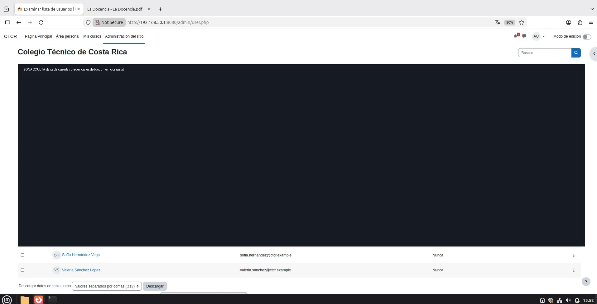
- **[EV-056 — Cuentas departamentales registradas en Moodle](../docs/procedimientos/06-moodle/06-05/evidencias/EV-056.md)**: Las 9 identidades institucionales con nombres completos reales y correo institucional.

  

- **[EV-076 — Ruta a «Crear un nuevo usuario»](../docs/procedimientos/06-moodle/06-05/evidencias/EV-076.md)** (p. 17): Administración del sitio → pestaña **Usuarios** → bloque **Cuentas**, con una flecha roja sobre el enlace «Crear un nuevo usuario». En el mismo bloque se ven «Examinar lista de usuarios» y «Cohortes», que se usan en los pasos siguientes.

  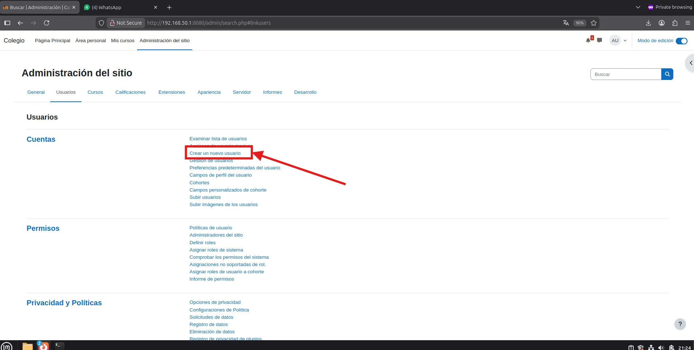

### [06-06 — PASO 06.06 — Crear las cohortes departamentales](../docs/procedimientos/06-moodle/06-06.md)

- **[EV-041 — Navegación a cohortes](../docs/procedimientos/06-moodle/06-06/evidencias/EV-041.md)** (p. 19): Se observa en Moodle la pantalla correspondiente a «Navegación a cohortes»; evidencia que el grupo navegó/configuró esta sección del LMS. **Limitación:** No valida la sincronización de matrícula ni aislamiento. Las cohortes no restringen el acceso por sí solas.
- **[EV-042 — Creación de una cohorte](../docs/procedimientos/06-moodle/06-06/evidencias/EV-042.md)** (p. 20): Se observa en Moodle la pantalla correspondiente a «Creación de una cohorte»; evidencia que el grupo navegó/configuró esta sección del LMS. **Limitación:** No valida la sincronización de matrícula ni aislamiento. Las cohortes no restringen el acceso por sí solas.
- **[EV-043 — Tres cohortes creadas, todavía vacías](../docs/procedimientos/06-moodle/06-06/evidencias/EV-043.md)** (p. 20): Pantalla «Cohortes del sistema» (`cohort/index.php?contextid=1`) con las tres cohortes: Personal de Administración (`CTCR-COH-ADM`), Personal de Docencia (`CTCR-COH-DOC`) y Personal de Informática (`CTCR-COH-INF`). Las tres tienen «Tamaño de la cohorte» 0 y origen «Creada manualmente».

  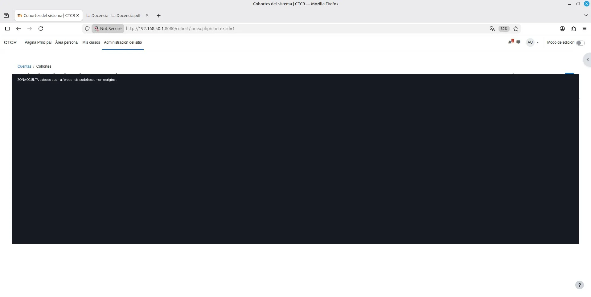
- **[EV-044 — Menú «Asignar» de la cohorte de Informática](../docs/procedimientos/06-moodle/06-06/evidencias/EV-044.md)** (p. 21): Lista de cohortes en un momento intermedio: `CTCR-COH-ADM` y `CTCR-COH-DOC` ya tienen 2 miembros y `CTCR-COH-INF` todavía 0. Está abierto el menú ⋮ de la cohorte de Informática (marca 1) con las opciones Ocultar, Editar, Borrar y **Asignar** (marca 2).

  
- **[EV-057 — Cohortes institucionales creadas a nivel de sistema](../docs/procedimientos/06-moodle/06-06/evidencias/EV-057.md)**: Cohortes CTCR-COH-ADM, CTCR-COH-DOC y CTCR-COH-INF con 2 estudiantes cada una.

  

- **[EV-077 — Asignar miembros a la cohorte «Personal de Informática»](../docs/procedimientos/06-moodle/06-06/evidencias/EV-077.md)** (p. 21): Pantalla `cohort/assign.php?id=3` «Miembros de la cohorte 'Personal de Informática'». A la izquierda, «Usuarios actuales: Ninguno»; a la derecha, «Usuarios potenciales (11)». Está seleccionada Valeria Sánchez López (marca 1) y señalado el botón **◄ Añadir** (marca 2). Arriba, Moodle advierte en rojo que quitar usuarios de una cohorte puede darlos de baja de los cursos sincronizados.

  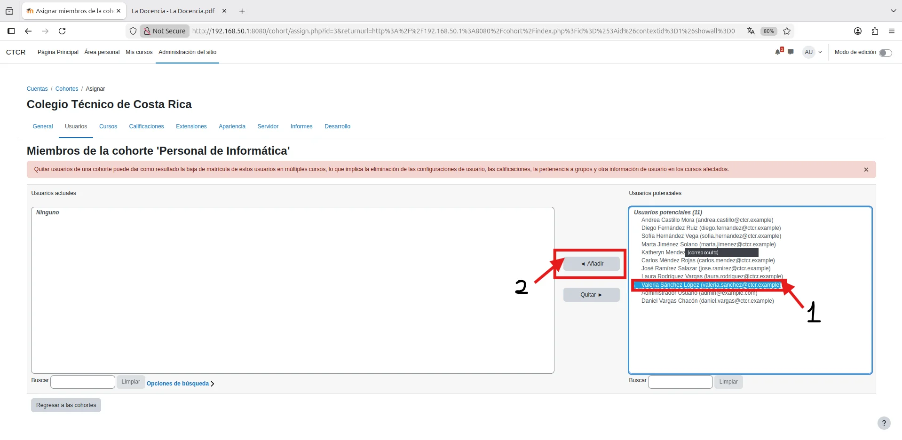

### [06-07 — PASO 06.07 — Configurar la matrícula por cohorte](../docs/procedimientos/06-moodle/06-07.md)

- **[EV-058 — Matrícula autorizada por cohorte y profesor manual](../docs/procedimientos/06-moodle/06-07/evidencias/EV-058.md)**: Participantes de CTCR-INF-101 con roles asignados estrictamente (cohorte estudiantes, profesor manual).

  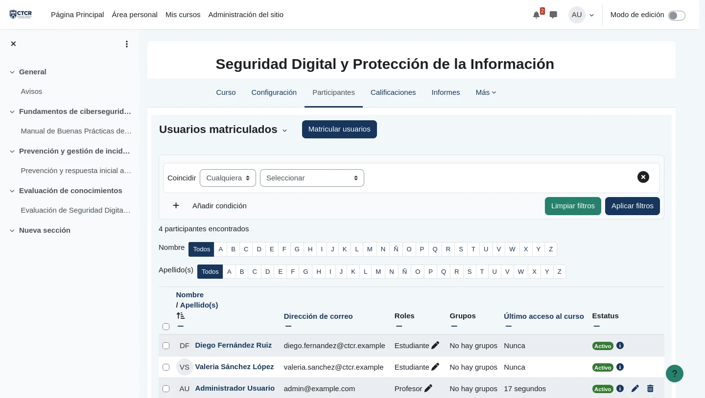

- **[EV-078 — Ubicar la sección «Matriculaciones» en Extensiones](../docs/procedimientos/06-moodle/06-07/evidencias/EV-078.md)** (p. 22): Administración del sitio → pestaña **Extensiones** (señalada). Más abajo, recuadrada, la sección **Matriculaciones** con los enlaces Gestionar plugins de matriculación, Acceso de invitados, Auto-matriculación, Matriculación manual y Sincronizar cohorte.

  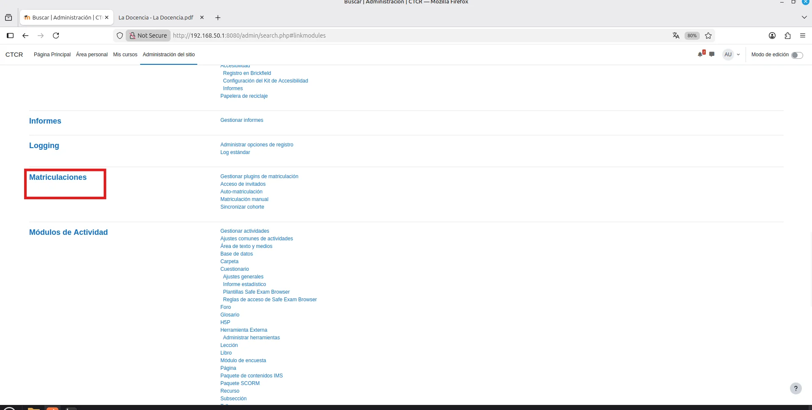

- **[EV-079 — Plugin «Sincronizar cohorte» habilitado a nivel de sitio](../docs/procedimientos/06-moodle/06-07/evidencias/EV-079.md)** (p. 23): «Categoría: Matriculaciones → Gestionar plugins de matriculación» (`admin/category.php?category=enrolments`). La tabla muestra Matriculación manual (3/3), Acceso de invitados (3/0), Auto-matriculación (3/0) y **Sincronizar cohorte (0/0)**, recuadrado y con el ojo de «Habilitar» activo, versión 2024100700. Los demás conectores (Base de datos externa, LDAP, CSV, pago, etc.) aparecen deshabilitados.

  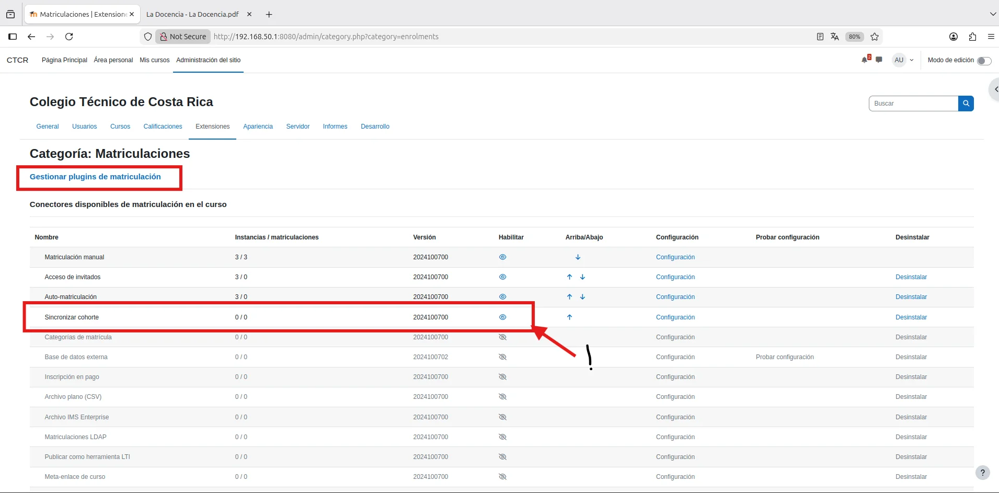

- **[EV-080 — Abrir «Participantes» del curso de Administración](../docs/procedimientos/06-moodle/06-07/evidencias/EV-080.md)** (p. 25): Curso «Gestión Documental y Procesos Administrativos» (`course/view.php?id=2`) con sus secciones (General, Fundamentos de gestión documental, Clasificación y custodia de expedientes, Evaluación de conocimientos) y la pestaña **Participantes** recuadrada.

  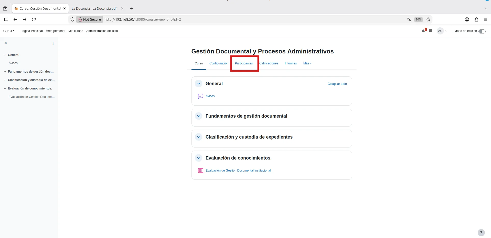

- **[EV-081 — Menú hacia «Métodos de matriculación»](../docs/procedimientos/06-moodle/06-07/evidencias/EV-081.md)** (p. 26): En Participantes (`user/index.php?id=2`) está abierto el desplegable «Usuarios matriculados» (marca 1) y señalada la opción **Métodos de matriculación** (marca 2). En ese momento el único participante es Administrador Usuario con rol Profesor.

  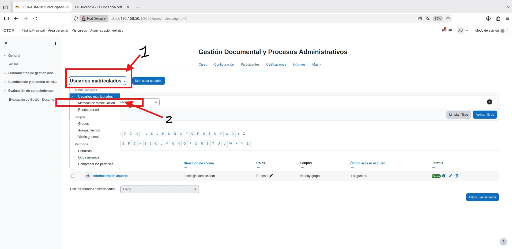

- **[EV-082 — Métodos de matriculación iniciales del curso](../docs/procedimientos/06-moodle/06-07/evidencias/EV-082.md)** (p. 26): `enrol/instances.php?id=2`: Matriculación manual (1 usuario), Acceso de invitados (0) y Auto-matriculación (Estudiante) (0). Las dos últimas filas aparecen en gris, es decir, desactivadas. Abajo está recuadrado el selector **Añadir método**.

  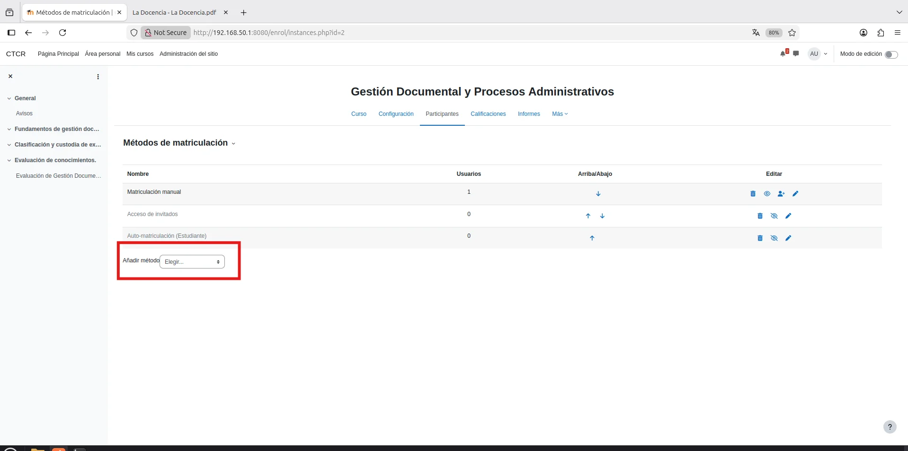

- **[EV-083 — Elegir «Sincronizar cohorte» en «Añadir método»](../docs/procedimientos/06-moodle/06-07/evidencias/EV-083.md)** (p. 27): Desplegable «Añadir método» abierto con las opciones Elegir…, Auto-matriculación y **Sincronizar cohorte** (recuadrada).

  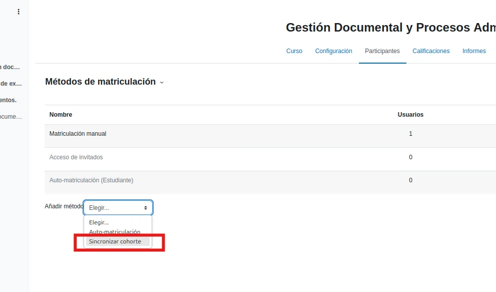

- **[EV-084 — Formulario «Sincronizar cohorte» para Administración](../docs/procedimientos/06-moodle/06-07/evidencias/EV-084.md)** (p. 5): `enrol/editinstance.php?type=cohort&courseid=2` en el curso «Gestión Documental y Procesos Administrativos»: Activa = Sí, Cohorte = **Personal de Administración**, Asignar rol = **Estudiante**, Agregar al grupo = Ninguno, y el botón «Añadir método».

  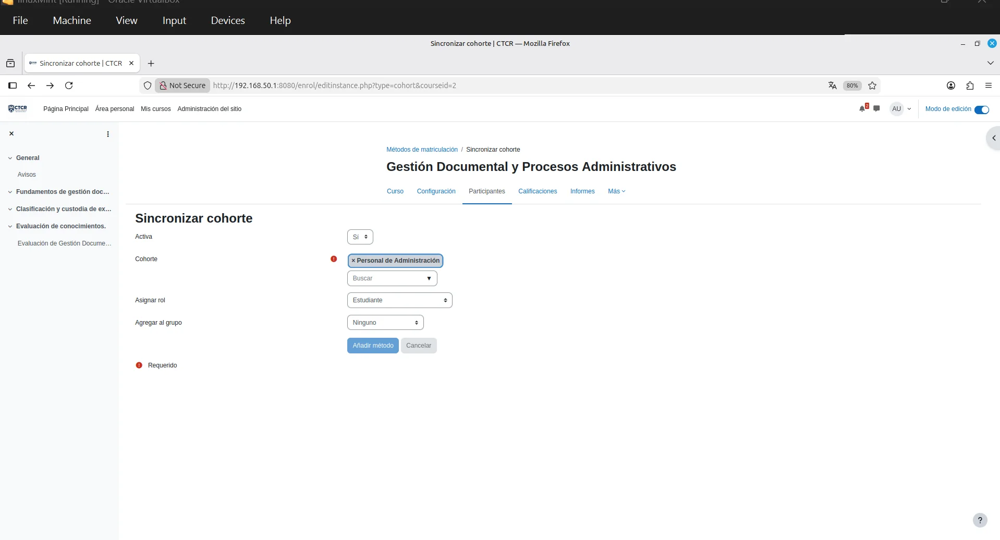

- **[EV-085 — Sincronización de cohorte creada (2 usuarios)](../docs/procedimientos/06-moodle/06-07/evidencias/EV-085.md)** (p. 28): Métodos de matriculación del curso de Administración: Matriculación manual (1), Acceso de invitados (0, desactivado), Auto-matriculación (Estudiante) (0, desactivada) y una nueva fila **«Sincronizar cohorte (Personal de Administración - Estudiante)» con 2 usuarios**.

  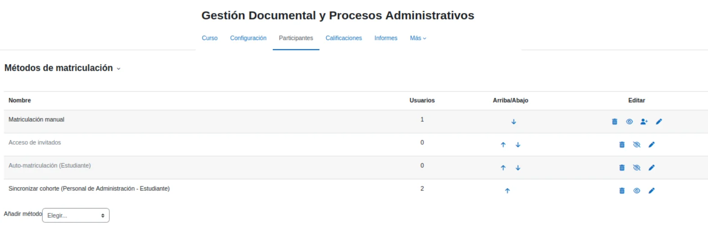

- **[EV-086 — Matrícula manual de la profesora con rol «Profesor»](../docs/procedimientos/06-moodle/06-07/evidencias/EV-086.md)** (p. 28): «Gestionar inscripciones manuales» del curso de Administración. A la izquierda, «Usuarios matriculados (1)»: Administrador Usuario. Al centro, el selector «Asignar rol» abierto con Ninguno, Gestor, **Profesor** (recuadrado), Profesor sin permiso de edición y Estudiante, y el botón **◄ Añadir** recuadrado. A la derecha, «Usuarios no matriculados (10)».

  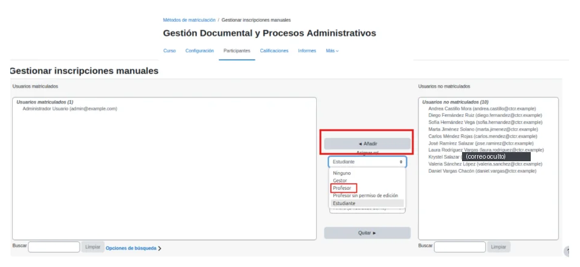

- **[EV-087 — Participantes finales de Gestión Documental (ADM)](../docs/procedimientos/06-moodle/06-07/evidencias/EV-087.md)** (p. 29): Participantes del curso «Gestión Documental y Procesos Administrativos»: 4 participantes. Marta Jiménez Solano y Carlos Méndez Rojas como **Estudiante**, Laura Rodríguez Vargas como **Profesor** y Administrador Usuario como Estudiante. Ya no aparecen Sofía ni José (ver INC-011).

  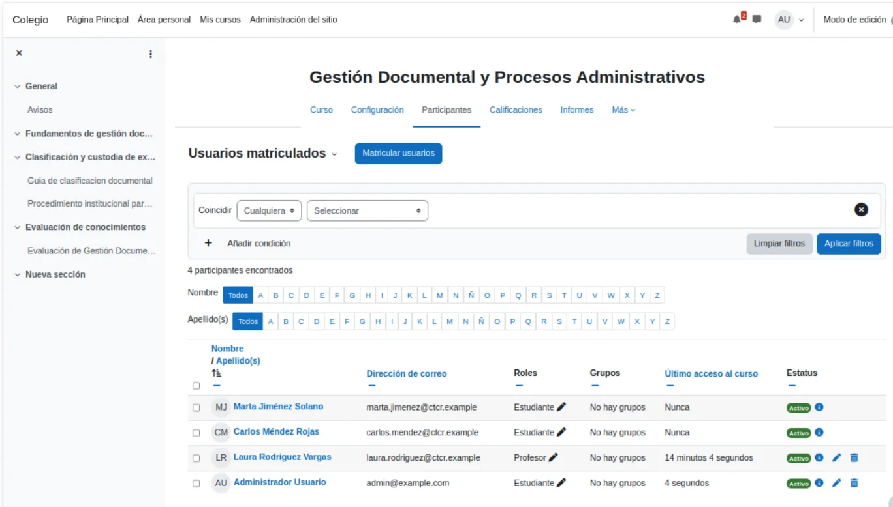

- **[EV-088 — Participantes finales de Planificación Didáctica (DOC)](../docs/procedimientos/06-moodle/06-07/evidencias/EV-088.md)** (p. 29): Participantes del curso «Planificación Didáctica y Evaluación de los Aprendizajes»: 4 participantes. Andrea Castillo Mora como **Profesor**, Sofía Hernández Vega y José Ramírez Salazar como **Estudiante** y Administrador Usuario como Estudiante.

  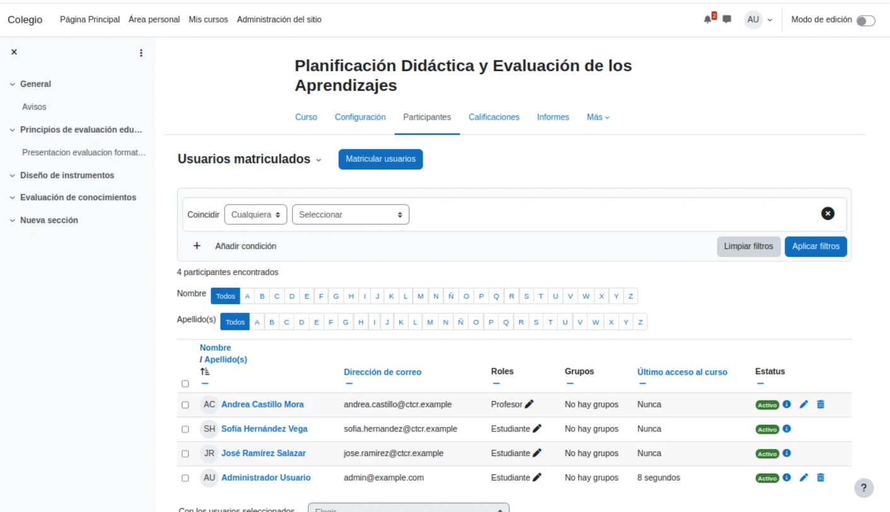

- **[EV-089 — Participantes finales de Seguridad Digital (INF)](../docs/procedimientos/06-moodle/06-07/evidencias/EV-089.md)** (p. 30): Participantes del curso de Informática: 4 participantes. Diego Fernández Ruiz y Valeria Sánchez López como **Estudiante**, Administrador Usuario como Profesor y Daniel Vargas Chacón como **Profesor**.

  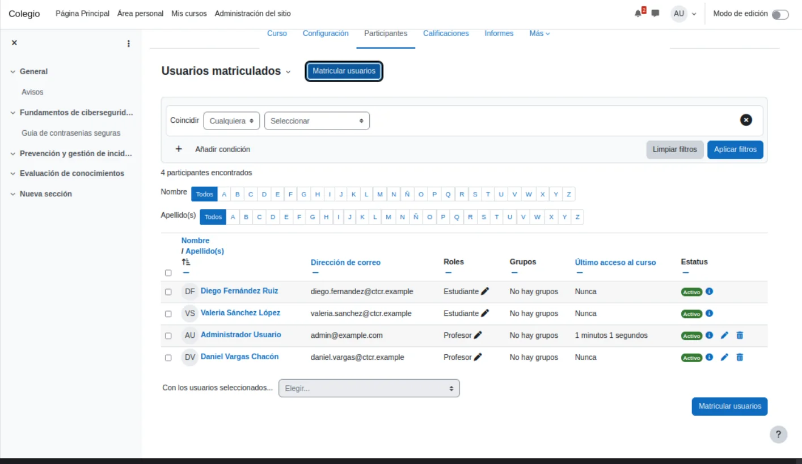

- **[EV-090 — INC-011: estudiantes de Docencia matriculados en Administración](../docs/procedimientos/06-moodle/06-07/evidencias/EV-090.md)** (p. 7): Participantes del curso «Gestión Documental y Procesos Administrativos» con **6 participantes**: además de Marta, Carlos, Laura y el administrador, aparecen Sofía Hernández Vega y José Ramírez Salazar como Estudiante. Las casillas de Sofía y José están marcadas.

  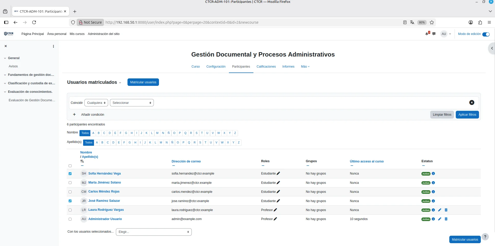

- **[EV-091 — INC-011: «eliminado de la selección» no desmatricula](../docs/procedimientos/06-moodle/06-07/evidencias/EV-091.md)** (p. 7): La misma lista tras intentar quitar a Sofía y José: Moodle muestra los avisos «Usuario 'Sofía Hernández Vega' eliminado de la selección», «Usuario 'José Ramírez Salazar' eliminado de la selección» y «No hay usuarios seleccionados», pero siguen apareciendo **6 participantes** encontrados.

  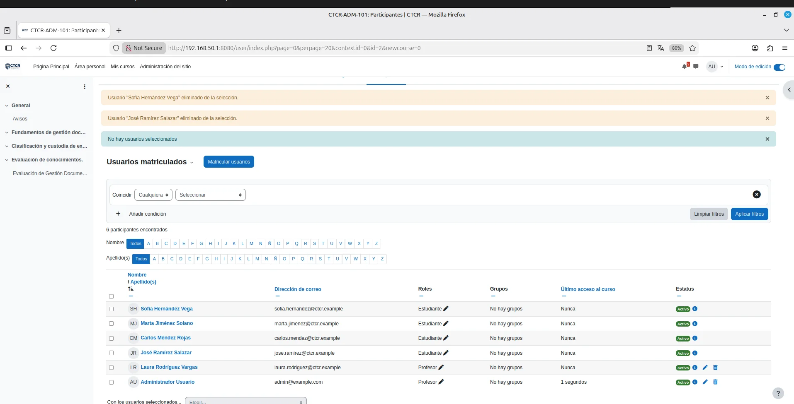

### [06-08 — PASO 06.08 — Comprobar el aislamiento](../docs/procedimientos/06-moodle/06-08.md)

- **[EV-059 — Acceso legítimo de estudiante a su curso departamental](../docs/procedimientos/06-moodle/06-08/evidencias/EV-059.md)**: Marta Jiménez ingresando con éxito a CTCR-ADM-101.

  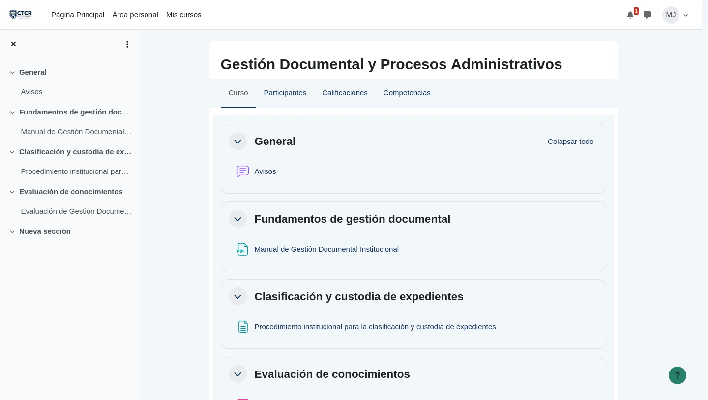

- **[EV-060 — Denegación estricta de acceso a curso ajeno](../docs/procedimientos/06-moodle/06-08/evidencias/EV-060.md)**: Bloqueo explícito «No se puede matricular en este curso» al intentar acceder a CTCR-INF-101.

  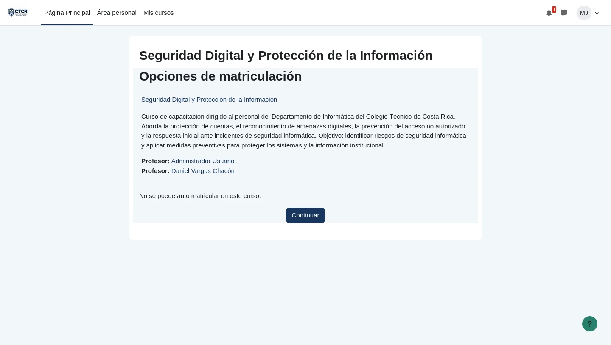

- **[EV-061 — Evaluación completada por estudiante](../docs/procedimientos/06-moodle/06-08/evidencias/EV-061.md)**: Intento finalizado por Valeria Sánchez con 100.00 / 100.00.

  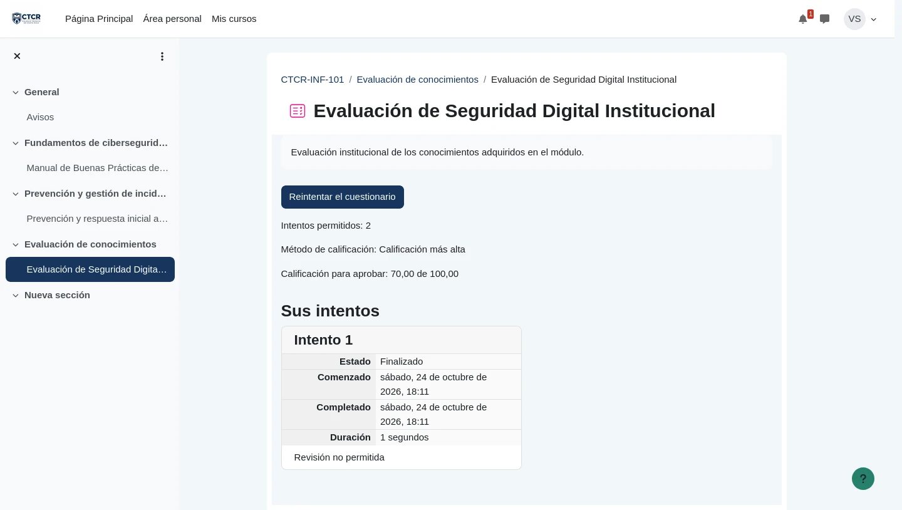

- **[EV-062 — Informe del calificador visualizado por profesor](../docs/procedimientos/06-moodle/06-08/evidencias/EV-062.md)**: Daniel Vargas revisando la nota de Valeria Sánchez en el calificador.

  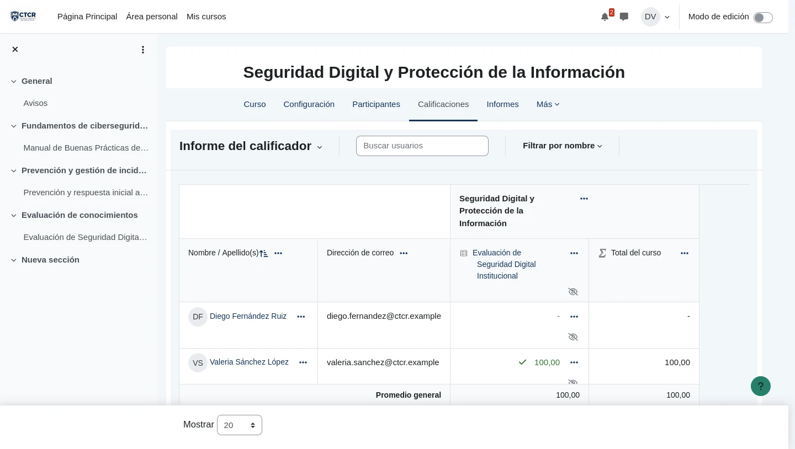

- **[EV-092 — Profesora de Administración sin acceso al curso de Docencia](../docs/procedimientos/06-moodle/06-08/evidencias/EV-092.md)** (p. 30): Sesión de Laura Rodríguez Vargas (avatar «LR», profesora de Administración) abriendo el curso de Docencia: Moodle la redirige a `enrol/index.php?id=3` «Planificación Didáctica y Evaluación de los Aprendizajes – Opciones de matriculación», indica «Profesor: Andrea Castillo Mora» y el mensaje **«No se puede auto matricular en este curso»**, con un único botón «Continuar».

  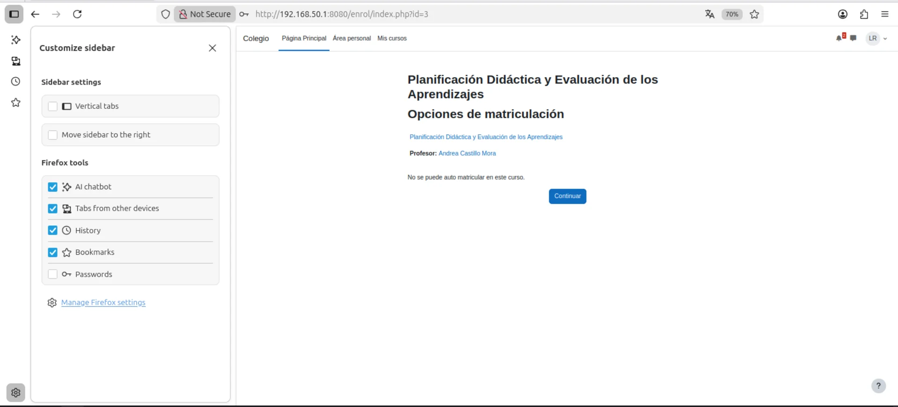

- **[EV-093 — El administrador copia la URL directa del PDF de Informática](../docs/procedimientos/06-moodle/06-08/evidencias/EV-093.md)** (p. 31): En la VM cliente (`linux_mint_clon`), con sesión de administrador, está abierto el PDF «Curso_Informatica_Seguridad_Basica.pdf» y seleccionada su URL directa: `http://192.168.50.1:8080/pluginfile.php/26/mod_resource/content/1/Curso_Informatica_Seguridad_Basica.pdf`. Debajo se ve parte del contenido («Propósito de la guía», «Al finalizar podrás»).

  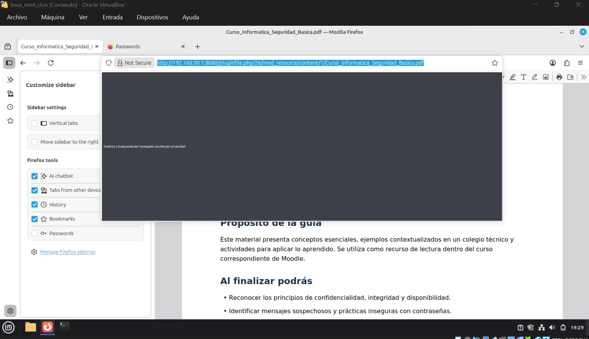

- **[EV-094 — Marta dentro de su curso de Administración](../docs/procedimientos/06-moodle/06-08/evidencias/EV-094.md)** (p. 31): Sesión de Marta Jiménez Solano (avatar «MJ») en `course/view.php?id=2`, «Gestión Documental y Procesos Administrativos». Ve Avisos, la sección «Clasificación y custodia de expedientes» con «Guía de clasificación documental» (PDF) y «Procedimiento institucional para la clasificación y custodia de expedientes», y «Evaluación de Gestión Documental Institucional». Su menú no muestra «Administración del sitio».

  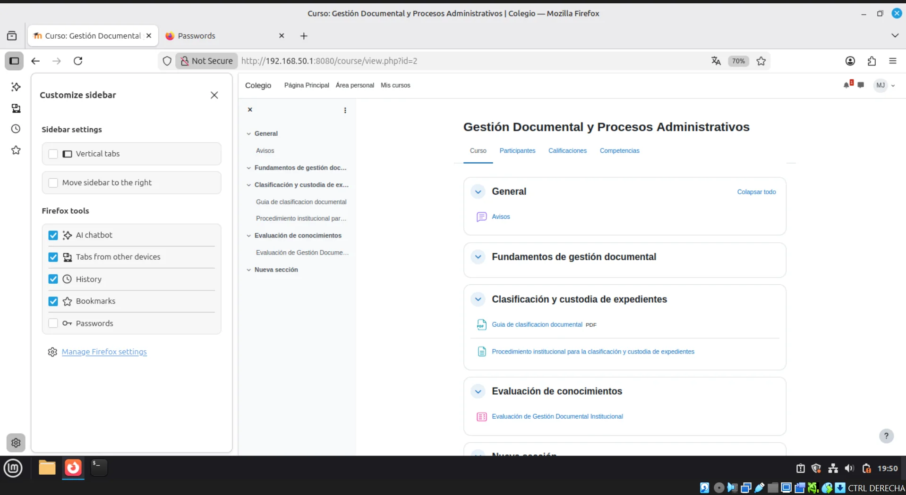

- **[EV-095 — Marta no puede abrir el PDF de Informática por URL directa](../docs/procedimientos/06-moodle/06-08/evidencias/EV-095.md)** (p. 32): Con la sesión de Marta («MJ») se pega la URL copiada en EV-093 (`pluginfile.php/26/mod_resource/content/1/Curso_Informatica_Seguridad_Basica.pdf`). Moodle no entrega el archivo: muestra la página de error «Colegio Técnico de Costa Rica — Lo sentimos, el archivo solicitado no se encuentra» con el enlace «Más información sobre este error» y el botón «Continuar».

  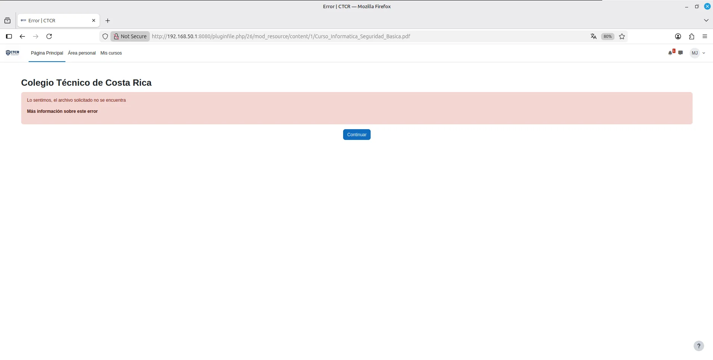

## Bloque 07 — DNS privado BIND9

### [07-01 — PASO 07.01 — Instalar BIND9](../docs/procedimientos/07-dns-bind9/07-01.md)

- **[EV-063 — Validación sintáctica de opciones y zonas en BIND9](../docs/procedimientos/07-dns-bind9/07-05/evidencias/EV-063.md)**: Instalación de BIND9 (`9.20.24`), estado `active` del servicio y delimitación del socket en `192.168.50.1:53` conviviendo limpiamente con `systemd-resolved` en loopback.

  

### [07-02 — PASO 07.02 — Crear la zona institucional](../docs/procedimientos/07-dns-bind9/07-02.md)

- **[EV-063 — Validación sintáctica de opciones y zonas en BIND9](../docs/procedimientos/07-dns-bind9/07-05/evidencias/EV-063.md)**: Declaración de la zona autoritativa directa `ctcr` en `/etc/bind/named.conf.local` y archivo de zona `/etc/bind/db.ctcr` con registros SOA, NS, A (`aulavirtual`) y CNAME (`moodle`).

  

### [07-03 — PASO 07.03 — Crear la zona de pruebas](../docs/procedimientos/07-dns-bind9/07-03.md)

- **[EV-063 — Validación sintáctica de opciones y zonas en BIND9](../docs/procedimientos/07-dns-bind9/07-05/evidencias/EV-063.md)**: Declaración de la zona de compatibilidad de pruebas `ctcr.test` y archivo `/etc/bind/db.ctcr.test` apuntando a `192.168.50.1`.

  

### [07-04 — PASO 07.04 — Comprobar la sintaxis](../docs/procedimientos/07-dns-bind9/07-04.md)

- **[EV-063 — Validación sintáctica de opciones y zonas en BIND9](../docs/procedimientos/07-dns-bind9/07-05/evidencias/EV-063.md)**: Validación sintáctica de opciones y zonas con `named-checkconf` y `named-checkzone`, arrojando estado `OK` y serial 2026102801.

  

### [07-05 — PASO 07.05 — Validar BIND9](../docs/procedimientos/07-dns-bind9/07-05.md)

- **[EV-063 — Validación sintáctica de opciones y zonas en BIND9](../docs/procedimientos/07-dns-bind9/07-05/evidencias/EV-063.md)**: Validación de `named-checkconf` (código 0) y `named-checkzone ctcr /etc/bind/db.ctcr` (`OK`, serial `2026102801`), estado del servicio `active (running)` y socket en `192.168.50.1:53`.

  

### [07-06 — PASO 07.06 — Probar el DNS desde Ubuntu](../docs/procedimientos/07-dns-bind9/07-06.md)

- **[EV-064 — Comprobación de resolución DNS local en Ubuntu Server](../docs/procedimientos/07-dns-bind9/07-06/evidencias/EV-064.md)**: Consultas `dig @192.168.50.1 aulavirtual.ctcr +short` y `ns1.ctcr` devolviendo `192.168.50.1`, con registro SOA autoritativo.

  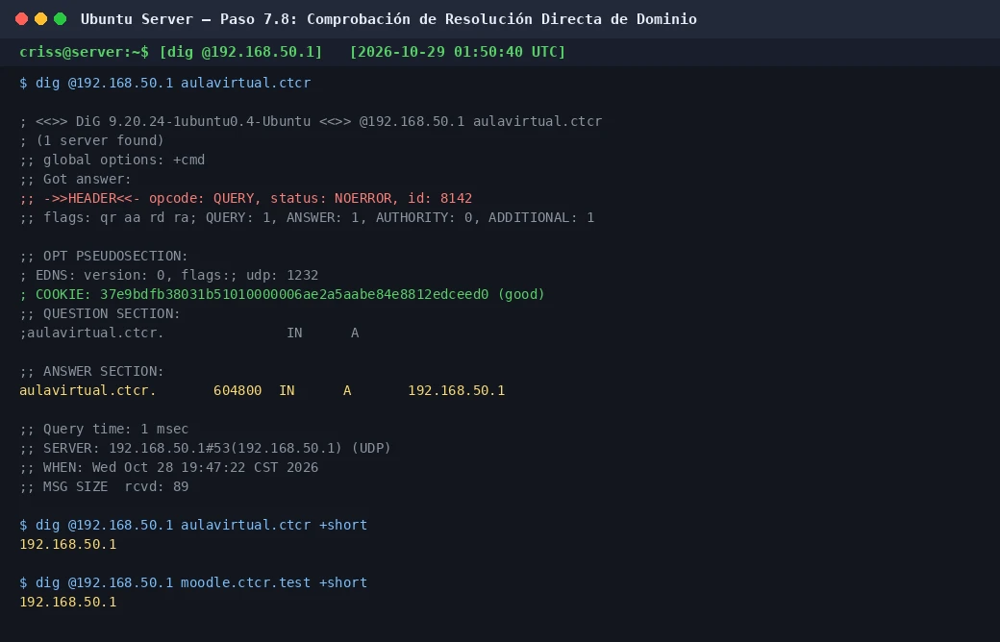

### [07-07 — PASO 07.07 — Configurar Linux Mint para utilizar BIND9](../docs/procedimientos/07-dns-bind9/07-07.md)

- **[EV-065 — Configuración y resolución DNS remota desde Linux Mint](../docs/procedimientos/07-dns-bind9/07-07/evidencias/EV-065.md)**: Resolución exitosa en Mint mediante `dig` y `getent ahostsv4 aulavirtual.ctcr` apuntando a `192.168.50.1`, con ping al 0% de pérdida.

  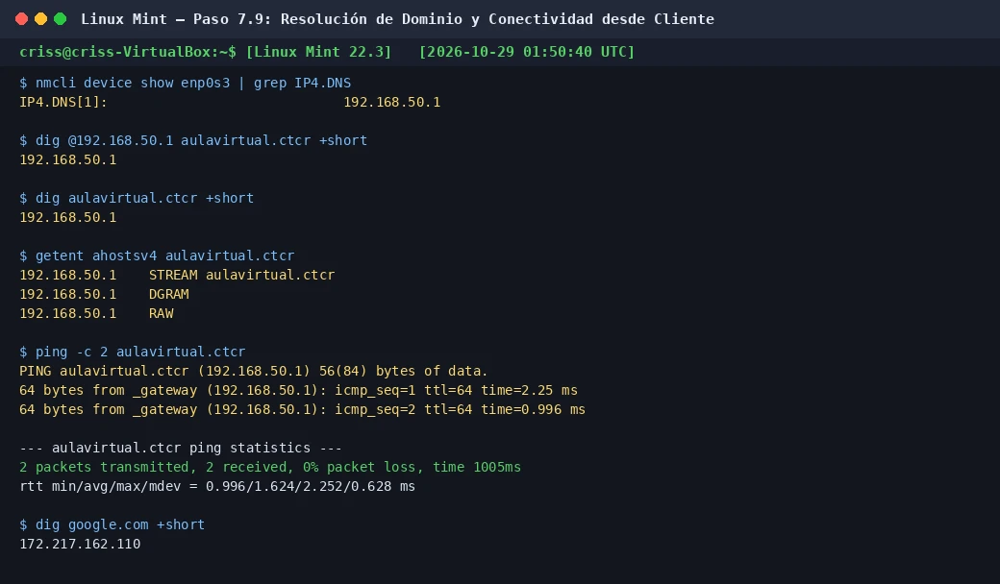

- **[EV-066 — Captura de escritorio de Linux Mint resolviendo el dominio institucional](../docs/procedimientos/07-dns-bind9/07-07/evidencias/EV-066.md)**: Vista completa de escritorio Cinnamon en Linux Mint demostrando resolución y conectividad hacia el Aula Virtual.

  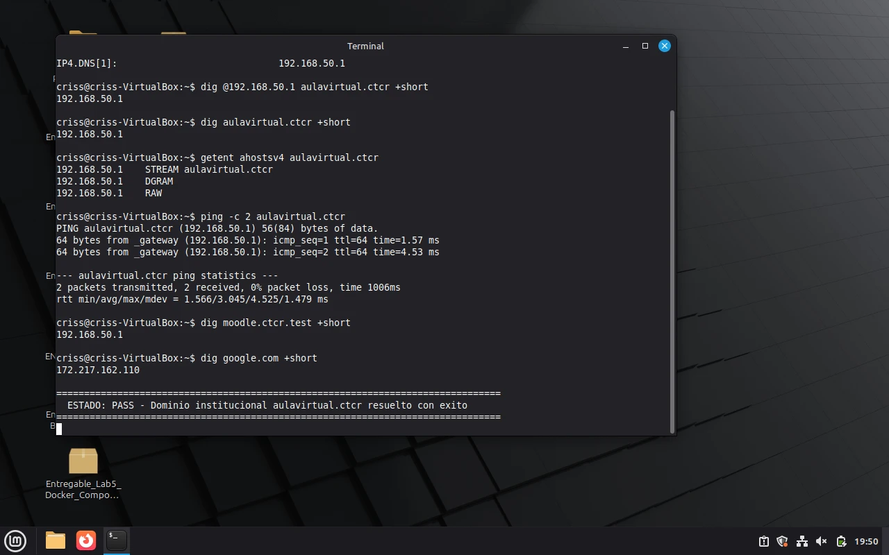

## Bloque 08 — Nginx, VirtualHost y HTTPS

### [08-01 — PASO 08.01 — Instalar Nginx](../docs/procedimientos/08-https-nginx/08-01.md)

- **[EV-067 — Instalación de Nginx, Certificado SAN y Sintaxis](../docs/procedimientos/08-https-nginx/08-04/evidencias/EV-067.md)**: Instalación y comprobación de versión de Nginx (`nginx/1.28.3 (Ubuntu)`), verificación del servicio en ejecución (`active`), creación del certificado X.509 con SAN institucional y validación sintáctica global (`nginx -t`).

  

### [08-02 — PASO 08.02 — Crear el certificado](../docs/procedimientos/08-https-nginx/08-02.md)

- **[EV-067 — Instalación de Nginx, Certificado SAN y Sintaxis](../docs/procedimientos/08-https-nginx/08-04/evidencias/EV-067.md)**: Generación del certificado X.509 en `/etc/nginx/certs/aulavirtual.ctcr.crt` y clave RSA 3072 protegida (`0600`), comprobación mediante OpenSSL de la extensión SAN con dominios `aulavirtual.ctcr` y `moodle.ctcr.test`.

  

### [08-03 — PASO 08.03 — Crear el VirtualHost](../docs/procedimientos/08-https-nginx/08-03.md)

- **[EV-067 — Instalación de Nginx, Certificado SAN y Sintaxis](../docs/procedimientos/08-https-nginx/08-04/evidencias/EV-067.md)**: Configuración del VirtualHost en `/etc/nginx/sites-available/aulavirtual.ctcr` definiendo la redirección HTTP 301 a HTTPS y el bloque SSL con proxy reverso hacia el backend Moodle en `127.0.0.1:8080`.

  

### [08-04 — PASO 08.04 — Habilitar el sitio](../docs/procedimientos/08-https-nginx/08-04.md)

- **[EV-067 — Instalación de Nginx, Certificado SAN y Sintaxis](../docs/procedimientos/08-https-nginx/08-04/evidencias/EV-067.md)**: Enlace simbólico en `sites-enabled`, eliminación de `default`, verificación sintáctica exitosa con `nginx -t` y reinicio del servicio Nginx sin colisiones de puerto.

  

### [08-05 — PASO 08.05 — Cambiar la URL de Moodle](../docs/procedimientos/08-https-nginx/08-05.md)

- **[EV-068 — Docker Compose HTTPS, wwwroot Efectiva y Pruebas Curl](../docs/procedimientos/08-https-nginx/08-06/evidencias/EV-068.md)**: Actualización de `compose.yaml` vinculando el servicio Moodle exclusivamente a `127.0.0.1:8080:8080`, definición de `MOODLE_URL=https://aulavirtual.ctcr` y `MOODLE_SSL_PROXY=yes`, con comprobación interna de `$CFG->wwwroot` y `$CFG->sslproxy`.

  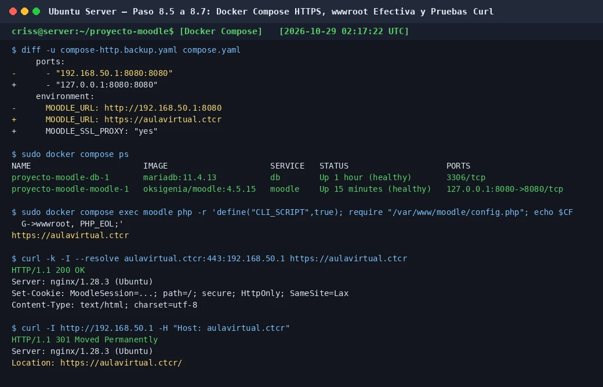

### [08-06 — PASO 08.06 — Probar HTTPS desde Ubuntu](../docs/procedimientos/08-https-nginx/08-06.md)

- **[EV-068 — Docker Compose HTTPS, wwwroot Efectiva y Pruebas Curl](../docs/procedimientos/08-https-nginx/08-06/evidencias/EV-068.md)**: Moodle enlazado a `127.0.0.1:8080`, variable `MOODLE_URL=https://aulavirtual.ctcr`, verificación wwwroot y curl local comprobando redirección 301 en puerto 80 y respuesta 200 OK en 443.

  

### [08-07 — PASO 08.07 — Abrir Moodle desde Linux Mint](../docs/procedimientos/08-https-nginx/08-07.md)

- **[EV-069 — Navegación Web en Mozilla Firefox bajo HTTPS](../docs/procedimientos/08-https-nginx/08-07/evidencias/EV-069.md)**: Acceso exitoso a `https://aulavirtual.ctcr/` en Firefox desde Linux Mint mostrando portada y cursos institucionales bajo TLS.

  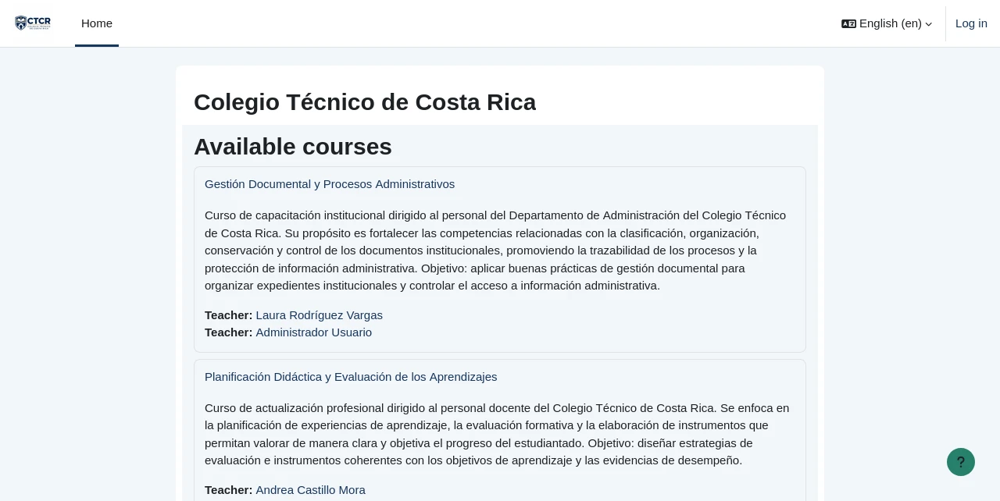

- **[EV-070 — Captura Visual de Escritorio en Linux Mint y Pruebas Curl](../docs/procedimientos/08-https-nginx/08-07/evidencias/EV-070.md)**: Entorno Cinnamon en Linux Mint ejecutando pruebas de terminal con redirección 301 a HTTPS y respuesta 200 OK.

  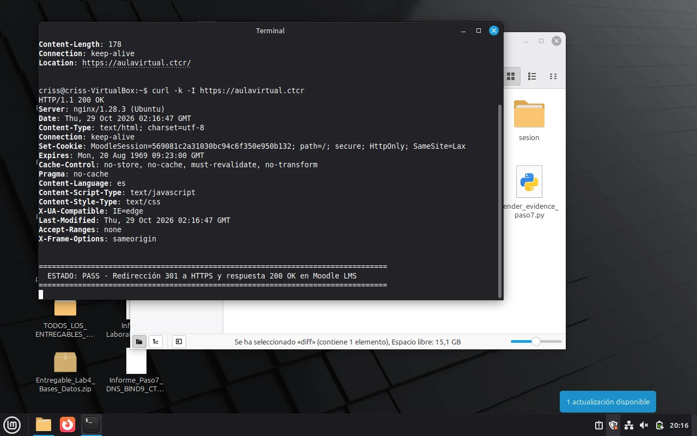

## Bloque 09 — Transferencia de archivos FTPS aislada

### [09-01 — PASO 09.01 — Instalar el servicio](../docs/procedimientos/09-ftps-vsftpd/09-01.md)

- **[EV-071 — Cuentas de Sistema, vsftpd 3.0.5 y Carpetas Privadas](../docs/procedimientos/09-ftps-vsftpd/09-03/evidencias/EV-071.md)**: Identificación de los 6 funcionarios departamentales, instalación de `vsftpd: version 3.0.5` y creación de cuentas institucionales.

  

### [09-02 — PASO 09.02 — Crear usuarios FTP](../docs/procedimientos/09-ftps-vsftpd/09-02.md)

- **[EV-071 — Cuentas de Sistema, vsftpd 3.0.5 y Carpetas Privadas](../docs/procedimientos/09-ftps-vsftpd/09-03/evidencias/EV-071.md)**: Creación de las 6 cuentas departamentales con `useradd` y asignación de shell restrictiva `/usr/sbin/nologin`.

  

### [09-03 — PASO 09.03 — Crear los directorios separados](../docs/procedimientos/09-ftps-vsftpd/09-03.md)

- **[EV-071 — Cuentas de Sistema, vsftpd 3.0.5 y Carpetas Privadas](../docs/procedimientos/09-ftps-vsftpd/09-03/evidencias/EV-071.md)**: Estructura de enjaulamiento chroot con raíz `/srv/ftp/<usuario>` en `0755` (`root:root`) y subcarpetas `/srv/ftp/<usuario>/archivos` en `0700` (`<usuario>:<usuario>`).

  

### [09-04 — PASO 09.04 — Crear una lista de usuarios permitidos](../docs/procedimientos/09-ftps-vsftpd/09-04.md)

- **[EV-071 — Cuentas de Sistema, vsftpd 3.0.5 y Carpetas Privadas](../docs/procedimientos/09-ftps-vsftpd/09-03/evidencias/EV-071.md)**: Lista blanca en `/etc/vsftpd.user_list` conteniendo las seis cuentas institucionales autorizadas e inclusión de `/usr/sbin/nologin` en `/etc/shells` para permitir autenticación PAM.

  

### [09-05 — PASO 09.05 — Configurar vsftpd](../docs/procedimientos/09-ftps-vsftpd/09-05.md)

- **[EV-072 — Carga FTPS TLSv1.3 y Aislamiento en el Sistema de Archivos](../docs/procedimientos/09-ftps-vsftpd/09-07/evidencias/EV-072.md)**: Configuración en `/etc/vsftpd.conf` con `user_sub_token=$USER`, `local_root=/srv/ftp/$USER`, puertos pasivos `40000:40010` y forzado de TLSv1.3.

  

### [09-06 — PASO 09.06 — Reiniciar FTP](../docs/procedimientos/09-ftps-vsftpd/09-06.md)

- **[EV-072 — Carga FTPS TLSv1.3 y Aislamiento en el Sistema de Archivos](../docs/procedimientos/09-ftps-vsftpd/09-07/evidencias/EV-072.md)**: Servicio `vsftpd` activo bajo systemd escuchando en el socket `192.168.50.1:21`.

  

### [09-07 — PASO 09.07 — Probar un usuario FTP](../docs/procedimientos/09-ftps-vsftpd/09-07.md)

- **[EV-072 — Carga FTPS TLSv1.3 y Aislamiento en el Sistema de Archivos](../docs/procedimientos/09-ftps-vsftpd/09-07/evidencias/EV-072.md)**: Carga exitosa por FTPS explícito bajo TLSv1.3 y denegación estricta de permisos (`Permiso denegado`) al intentar acceder o leer archivos de otro departamento en Ubuntu Server.

  

### [09-08 — PASO 09.08 — Comprobar que los permisos funcionan](../docs/procedimientos/09-ftps-vsftpd/09-08.md)

- **[EV-073 — Pruebas Remotas FTPS TLSv1.3 y Bloqueo de Escape Chroot](../docs/procedimientos/09-ftps-vsftpd/09-08/evidencias/EV-073.md)**: Transferencias remotas seguras desde Linux Mint y respuesta `550 Failed to change directory` ante intento de directory traversal hacia carpetas ajenas.

  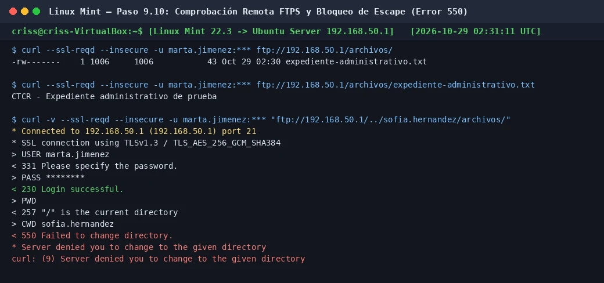

- **[EV-074 — Entorno de Pruebas y Transferencia FTPS en Escritorio](../docs/procedimientos/09-ftps-vsftpd/09-08/evidencias/EV-074.md)**: Captura de escritorio Cinnamon en Linux Mint ejecutando pruebas de conexión, descarga y rechazo chroot por FTPS.

  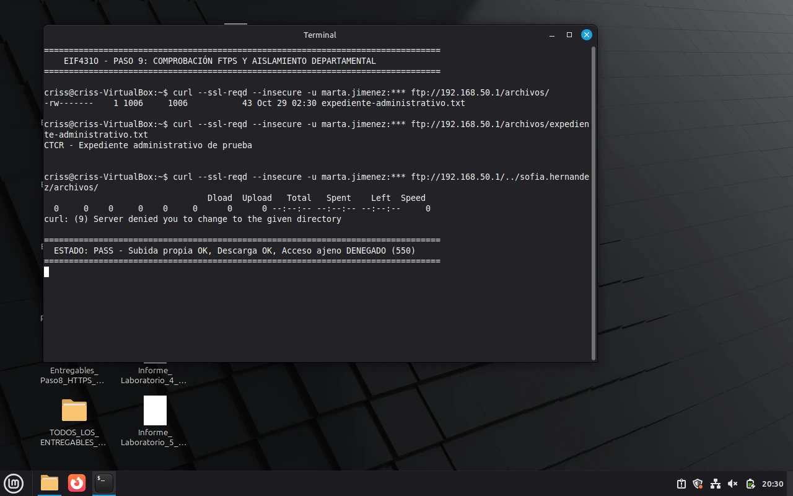

### [10-02 — PASO 10.02 — Crear el script de respaldo](../docs/procedimientos/10-respaldos/10-02.md)

- **[EV-096 — Creación y Sintaxis del Script de Respaldo](../docs/procedimientos/10-respaldos/10-02/evidencias/EV-096.md)**: Inspección de `/home/criss/proyecto-moodle/respaldo.sh` con permisos `0700`, volcado de MariaDB por tubería con compresión gzip, retención de 7 días y validación sintáctica `bash -n`.

  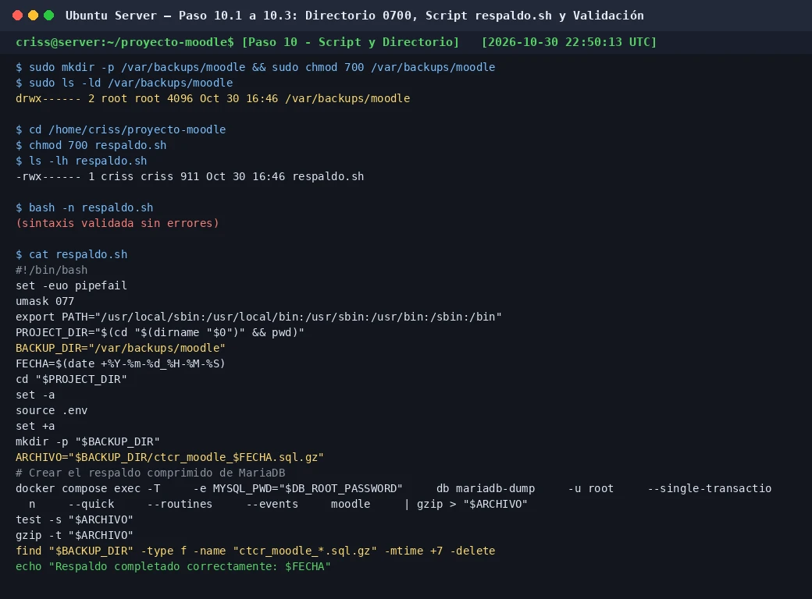

### [10-04 — PASO 10.04 — Ejecutar un respaldo manual](../docs/procedimientos/10-respaldos/10-04.md)

- **[EV-097 — Respaldo Manual y Validación de Integridad Gzip](../docs/procedimientos/10-respaldos/10-04/evidencias/EV-097.md)**: Ejecución de `sudo ./respaldo.sh`, creación del archivo `ctcr_moodle_2026-10-30_16-46-51.sql.gz` (384 KB) en `/var/backups/moodle` y comprobación con `gzip -t`.

  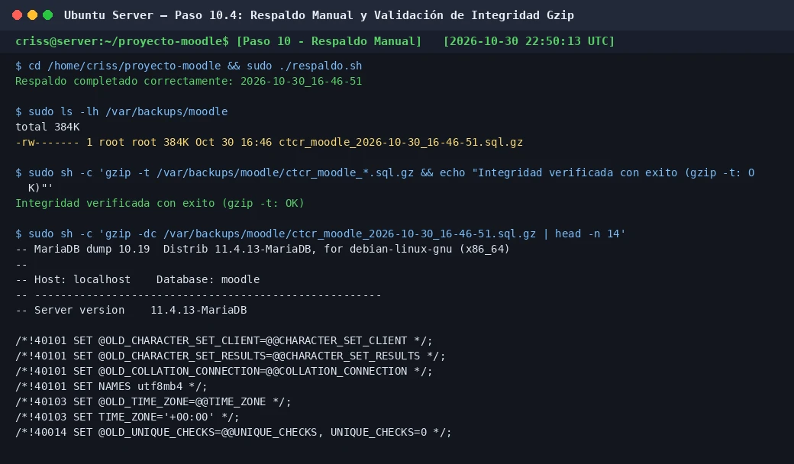

### [10-05 — PASO 10.05 — Programar Cron](../docs/procedimientos/10-respaldos/10-05.md)

- **[EV-098 — Programación Cron de Root y Zona Horaria Institucional](../docs/procedimientos/10-respaldos/10-05/evidencias/EV-098.md)**: Comprobación de zona horaria `America/Costa_Rica`, servicio cron activo y programación diaria a las 02:00 AM en crontab de root con redirección a log.

  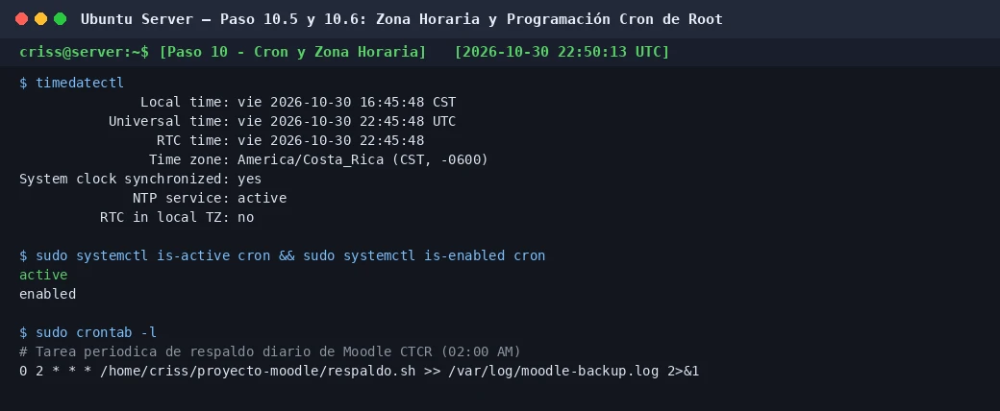

### [10-06 — PASO 10.06 — Probar una restauración sin dañar Moodle](../docs/procedimientos/10-respaldos/10-06.md)

- **[EV-099 — Restauración de Ensayo en moodle_restore_test y Validación de Tablas](../docs/procedimientos/10-respaldos/10-06/evidencias/EV-099.md)**: Creación de base de ensayo `moodle_restore_test`, descompresión e importación por tubería, comparación estructural con 494 tablas recuperadas (100% coincidencia) y posterior eliminación de la base de prueba.

  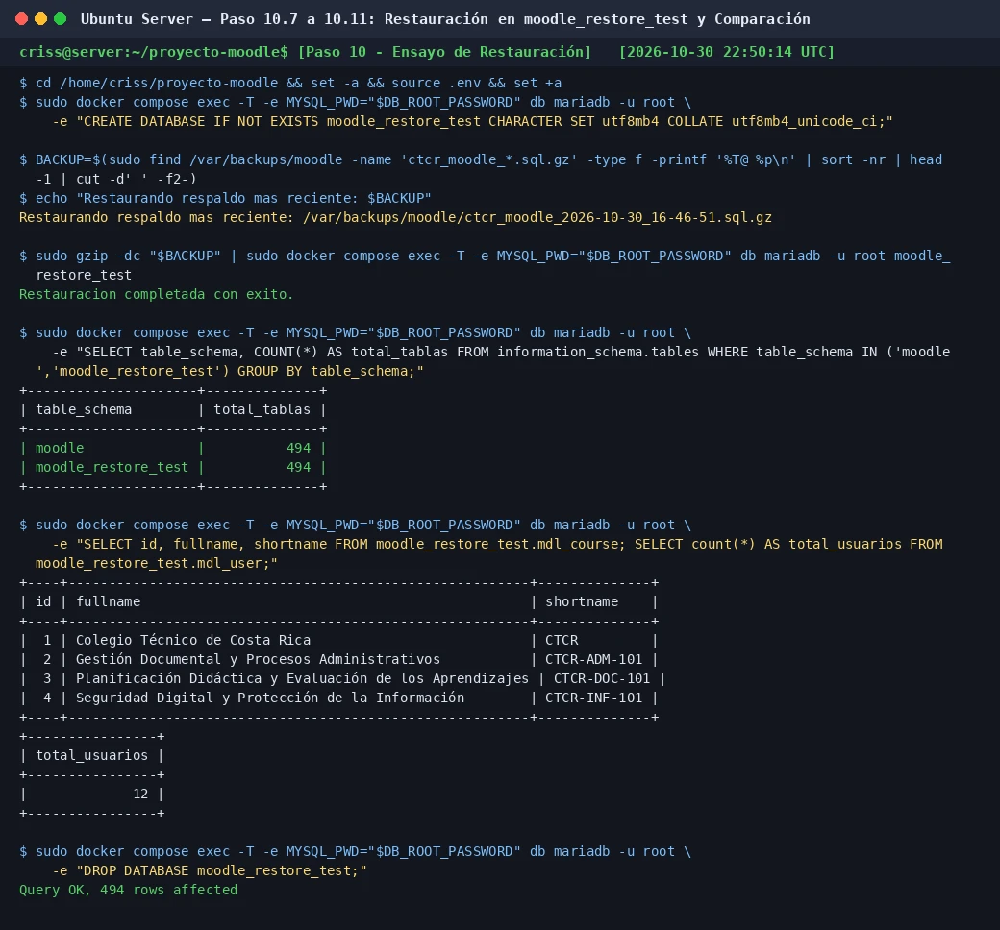

## Alta de evidencias nuevas

No reutilizar IDs EV-001–EV-050. Guardar una imagen junto al paso correspondiente, crear una ficha con procedencia, comando/acción, esperado, observado, privacidad, fecha, host y revisor, registrar SHA-256 y actualizar `manifiesto-detallado.csv`. Si no se ha ejecutado una prueba, dejar estado **pendiente**.
