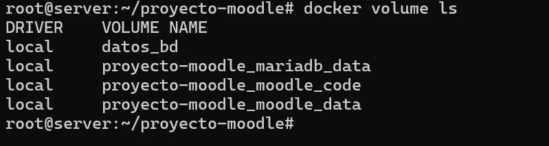

# Catálogo de las 50 capturas recuperadas

**Fuente:** última bitácora de 26 páginas. Estas capturas documentan acciones observadas en una sesión grupal o una VM; no validan todas las máquinas. Se exportaron en el mismo orden en que aparecen dentro del DOCX. Para cada imagen se conserva página y paso propuesto. Algunas zonas con credenciales o personas se han ocultado con rectángulos; las imágenes originales permanecen exclusivamente en el DOCX original, no en Git.

### EV-001: Mint: ping hacia Ubuntu Server

- Página original: 2; procedimiento: `01-01`.
- Estado: **captura histórica**, no verificación final.
- Tratamiento: revisar antes de publicación pública.

### EV-002: Ubuntu: ping hacia Mint

- Página original: 2; procedimiento: `01-01`.
- Estado: **captura histórica**, no verificación final.
- Tratamiento: revisar antes de publicación pública.

### EV-003: Ubuntu: conectividad exterior

- Página original: 3; procedimiento: `01-02`.
- Estado: **captura histórica**, no verificación final.
- Tratamiento: revisar antes de publicación pública.

### EV-004: Etiquetas de las imágenes Docker verificadas

- Página original: 3; procedimiento: `04-02`.
- Estado: **captura histórica**, no verificación final.
- Tratamiento: revisar antes de publicación pública.

### EV-005: OpenSSL: generación del archivo privado .env

- Página original: 3; procedimiento: `04-03`.
- Estado: **captura histórica**, no verificación final.
- Tratamiento: revisar antes de publicación pública.

### EV-006: Protección de permisos del .env

- Página original: 3; procedimiento: `04-03`.
- Estado: **captura histórica**, no verificación final.
- Tratamiento: revisar antes de publicación pública.

### EV-007: Primer bloque de configuración Compose

- Página original: 4; procedimiento: `04-04`.
- Estado: **captura histórica**, no verificación final.
- Tratamiento: revisar antes de publicación pública.

### EV-008: Segundo bloque de configuración Compose

- Página original: 5; procedimiento: `04-04`.
- Estado: **captura histórica**, no verificación final.
- Tratamiento: revisar antes de publicación pública.

### EV-009: Compose config, pull e imágenes

- Página original: 6; procedimiento: `04-06`.
- Estado: **captura histórica**, no verificación final.
- Tratamiento: revisar antes de publicación pública.

### EV-010: docker compose up y estado de los servicios

- Página original: 6; procedimiento: `04-07`.
- Estado: **captura histórica**, no verificación final.
- Tratamiento: revisar antes de publicación pública.

### EV-011: Registros iniciales de MariaDB

- Página original: 6; procedimiento: `04-07`.
- Estado: **captura histórica**, no verificación final.
- Tratamiento: revisar antes de publicación pública.

### EV-012: Registros de instalación de Moodle

- Página original: 6; procedimiento: `04-07`.
- Estado: **captura histórica**, no verificación final.
- Tratamiento: revisar antes de publicación pública.

### EV-013: Inicio de sesión en MariaDB con credenciales del .env

- Página original: 7; procedimiento: `04-08`.
- Estado: **captura histórica**, no verificación final.
- Tratamiento: credencial de base de datos en captura original.

### EV-014: Consulta SHOW TABLES de Moodle

- Página original: 7; procedimiento: `04-08`.
- Estado: **captura histórica**, no verificación final.
- Tratamiento: revisar antes de publicación pública.

### EV-015: Persistencia: docker volume ls

- Página original: 7; procedimiento: `04-09`.
- Estado: **captura histórica**, no verificación final.
- Tratamiento: revisar antes de publicación pública.

### EV-016: Pantalla inicial de Moodle

- Página original: 8; procedimiento: `05-02`.
- Estado: **captura histórica**, no verificación final.
- Tratamiento: revisar antes de publicación pública.

### EV-017: Perfil del administrador Moodle

- Página original: 8; procedimiento: `05-02`.
- Estado: **captura histórica**, no verificación final.
- Tratamiento: revisar antes de publicación pública.

### EV-018: Recreación de contenedores para comprobar persistencia

- Página original: 8; procedimiento: `05-03`.
- Estado: **captura histórica**, no verificación final.
- Tratamiento: revisar antes de publicación pública.

### EV-019: Ajustes de la portada de Moodle

- Página original: 9; procedimiento: `06-01`.
- Estado: **captura histórica**, no verificación final.
- Tratamiento: revisar antes de publicación pública.

### EV-020: Categorías de Administración, Docencia e Informática

- Página original: 9; procedimiento: `06-02`.
- Estado: **captura histórica**, no verificación final.
- Tratamiento: revisar antes de publicación pública.

### EV-021: Gestión de cursos en Moodle

- Página original: 10; procedimiento: `06-03`.
- Estado: **captura histórica**, no verificación final.
- Tratamiento: revisar antes de publicación pública.

### EV-022: Edición del curso de Docencia

- Página original: 10; procedimiento: `06-03`.
- Estado: **captura histórica**, no verificación final.
- Tratamiento: revisar antes de publicación pública.

### EV-023: Edición del curso de Informática

- Página original: 10; procedimiento: `06-04`.
- Estado: **captura histórica**, no verificación final.
- Tratamiento: revisar antes de publicación pública.

### EV-024: Selector de tipo de recurso

- Página original: 11; procedimiento: `06-04`.
- Estado: **captura histórica**, no verificación final.
- Tratamiento: revisar antes de publicación pública.

### EV-025: Carga de recurso PDF en Moodle

- Página original: 11; procedimiento: `06-04`.
- Estado: **captura histórica**, no verificación final.
- Tratamiento: revisar antes de publicación pública.

### EV-026: Secciones del curso de Informática

- Página original: 12; procedimiento: `06-04`.
- Estado: **captura histórica**, no verificación final.
- Tratamiento: revisar antes de publicación pública.

### EV-027: Selector de actividades para cuestionario

- Página original: 12; procedimiento: `06-04`.
- Estado: **captura histórica**, no verificación final.
- Tratamiento: revisar antes de publicación pública.

### EV-028: Configuración del cuestionario y puntuación

- Página original: 13; procedimiento: `06-05`.
- Estado: **captura histórica**, no verificación final.
- Tratamiento: revisar antes de publicación pública.

### EV-029: Cuestionario creado en el curso

- Página original: 13; procedimiento: `06-05`.
- Estado: **captura histórica**, no verificación final.
- Tratamiento: revisar antes de publicación pública.

### EV-030: Pestaña de preguntas del cuestionario

- Página original: 14; procedimiento: `06-05`.
- Estado: **captura histórica**, no verificación final.
- Tratamiento: revisar antes de publicación pública.

### EV-031: Añadir pregunta al cuestionario

- Página original: 14; procedimiento: `06-05`.
- Estado: **captura histórica**, no verificación final.
- Tratamiento: revisar antes de publicación pública.

### EV-032: Selector de tipo de pregunta

- Página original: 15; procedimiento: `06-05`.
- Estado: **captura histórica**, no verificación final.
- Tratamiento: revisar antes de publicación pública.

### EV-033: Formulario de pregunta de opción múltiple

- Página original: 15; procedimiento: `06-05`.
- Estado: **captura histórica**, no verificación final.
- Tratamiento: revisar antes de publicación pública.

### EV-034: Opciones de respuesta

- Página original: 16; procedimiento: `06-05`.
- Estado: **captura histórica**, no verificación final.
- Tratamiento: revisar antes de publicación pública.

### EV-035: Ponderación de respuesta correcta

- Página original: 16; procedimiento: `06-05`.
- Estado: **captura histórica**, no verificación final.
- Tratamiento: revisar antes de publicación pública.

### EV-036: Vista del cuestionario creado

- Página original: 17; procedimiento: `06-05`.
- Estado: **captura histórica**, no verificación final.
- Tratamiento: revisar antes de publicación pública.

### EV-037: Vista del cuestionario después de crear las preguntas

- Página original: 17; procedimiento: `06-05`.
- Estado: **captura histórica**, no verificación final.
- Tratamiento: revisar antes de publicación pública.

### EV-038: Navegación de administración a cuentas de usuario

- Página original: 18; procedimiento: `06-06`.
- Estado: **captura histórica**, no verificación final.
- Tratamiento: revisar antes de publicación pública.

### EV-039: Formulario de creación de usuario Moodle

- Página original: 18; procedimiento: `06-06`.
- Estado: **captura histórica**, no verificación final.
- Tratamiento: datos de cuentas de usuario.

### EV-040: Lista ampliada de cuentas de usuario

- Página original: 19; procedimiento: `06-06`.
- Estado: **captura histórica**, no verificación final.
- Tratamiento: datos de cuentas de usuario.

### EV-041: Navegación a cohortes

- Página original: 19; procedimiento: `06-06`.
- Estado: **captura histórica**, no verificación final.
- Tratamiento: revisar antes de publicación pública.

### EV-042: Creación de una cohorte

- Página original: 20; procedimiento: `06-06`.
- Estado: **captura histórica**, no verificación final.
- Tratamiento: revisar antes de publicación pública.

### EV-043: Lista de cohortes departamentales

- Página original: 20; procedimiento: `06-06`.
- Estado: **captura histórica**, no verificación final.
- Tratamiento: lista de miembros de cohortes.

### EV-044: Gestión de usuarios asignados a cohortes

- Página original: 21; procedimiento: `06-06`.
- Estado: **captura histórica**, no verificación final.
- Tratamiento: lista de miembros de cohortes.

### EV-045: Navegación a personalización

- Página original: 21; procedimiento: `06-01`.
- Estado: **captura histórica**, no verificación final.
- Tratamiento: revisar antes de publicación pública.

### EV-046: Opción de editar la página principal

- Página original: 22; procedimiento: `06-01`.
- Estado: **captura histórica**, no verificación final.
- Tratamiento: revisar antes de publicación pública.

### EV-047: Información institucional del Colegio

- Página original: 22; procedimiento: `06-01`.
- Estado: **captura histórica**, no verificación final.
- Tratamiento: revisar antes de publicación pública.

### EV-048: Administración del sitio

- Página original: 23; procedimiento: `06-01`.
- Estado: **captura histórica**, no verificación final.
- Tratamiento: revisar antes de publicación pública.

### EV-049: Menú de apariencia de Moodle

- Página original: 23; procedimiento: `06-01`.
- Estado: **captura histórica**, no verificación final.
- Tratamiento: revisar antes de publicación pública.

### EV-050: Diagnóstico de disco lleno y ampliación LVM

- Página original: 25; procedimiento: `01-02`.
- Estado: **captura histórica**, no verificación final.
- Tratamiento: revisar antes de publicación pública.

